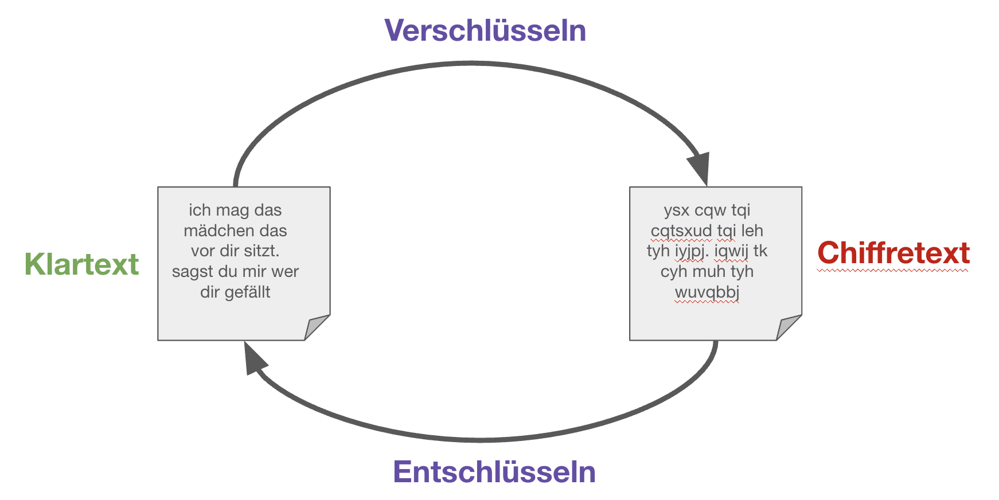

# a.  Analyse des Stoffs

Obwohl bei der professionelle Kryptopgrahie viel Mathematik als Vorwissen erwartet wird, dürfen wir die Gynmasiasten nicht überfordern. Wir stellen zuerst die Ideen die der Kryptographie vor: Wie kann man Geheimmitteilungen einander zusenden lassen.

Inder ersten Lektion würden wir die vier LEktionen kurz vorstellen, und was wir ihnen in diesen Lektionen lehren werden. 
Nach einem Beispiel vom Skytale, sowie auch der Gartenzaunverschlüsselung, kommen die zwei Hauptprozesse **Verschlüsselung** und **Entschlüsselung** ins Spiel. Bei der **Verschlüsselung**, handelt es sich irgendeinen Text in eine Geheimnachricht zu verändern, und bei der **Entschlüsselung** kan man den Text wieder herstellen. Diese zwei Begriffe stehen auch in Relation zu **Klartext** und **Chiffretext**, welches mit der Einführung zu Skytale und dem Gartenzaunverschlüsselung offenbar wird: Bei der Verschlüsselung nutzt man Klartext, bei der Entschlüsselung, den Chiffretext. All diese Begriffe sind wahrscheinlich neu für die Schüler, die möglicherweise noch nie eine Lektion in Kryptographie hatten. Da diese vier Wörter das Fundament der Kryptopgraphie bilden, lohnt es sich da noch ein Bild davon zu erstellen.

Da beide Methoden **Transposition** brauchen, wird diese Wort erklärt. Diese ist eine bestimmte Methode Daten zu verschlüsseln. 

Sobald diese paar Ideen eingeführt wurden, können sich die Schüler überlegen wie genau man Dinge entschlüsselt. Bei der Skytale und dem Gartenzaumverschlüsselung (sowie allen Transpositionsmethoden), ist es klar, dass man nur eine Wahl an Transpositionen hat: Sobald man den Trick kennt, ist der Sinn der Sache verloren, und somit, geht es zum Thema **Substitution**, eine andere Art zu Verschlüsseln. Dabie wird hier nun zum ersten mal der **Schlüssel** wird beschrieben, was den Schülern zeigt, dass man mit einem **Shared Secret** Daten verschlüsseln kann. Dabei steht **Schlüssel** in direkter Relation zu **Verschlüsseln** und **Entschlüsseln**. Bei Symmetrischen Kyptosystemen (die Systeme die wir unterrichten würden), ist dies der gleiche Schlüssel, weswegen wir den Metaphor gut nutzen können: Wie ein Schliessfach. 

Anstatt dass wir nun nur __eine__ Möglichkeit hat wie man entschlüsselt\verschlüsselt, wie bei der Transposition, bietet die Caesarverschlüsselung mehrere Möglichkeiten an. Ohne dem Wissen von der Verschiebung können wir es nicht lesen. Aber wenn wir drauf beharren, können wir trotzdem den Klartext herausfinden, indem wir den Schlüssel mit einer Frequenzanalyse **finden**. Man würde den Schülern vorzeigen wie man Caesar knacken kann, indem man die Anzahl Buchstaben zählt, und daraus die Verschiebung herausfinden kann. So ein Verfahren ist eine **Kryptanalyse**, ein Prozess einen Chiffretext ohne Schlüssel in Klartext zu verwandeln. Da nun Schüler dies selber gemacht haben, ist die Caesarverschlüssung wenig nützlich, und es muss eine neue Methode entwickelt werden. Dieser Prozess nennt sich **Kryptographie**. D.h. **Kryptographie** = neue Methoden entwicklen, **Kryptanalysis** = Versuchung den Code zu knacken.

Mit Caesar zu einfach, kann auch gezeigt werden dass alle Verschlüsselungen die nur einen Buchstaben mit einem anderen Ersetzen nicht gut genug ist. Darum würde man **monoalphabetische Substitution** mit **polyalphabetischer Substitution vergleichen, insbesondere mit dem Vignère Chiffre. Wieder kommt der Schlüssel vor, was dann zurück zur Kryptographie führt, und wiederum in die Kryptoanalyse.

...

# b. Leitidee & Algorithmisches Denken
Die Leitidee der Lektionen ist es, durch bestimmte, strukturierte Methoden Daten von einer Sichtweise zu einer anderen zu ändern. Bei jedem Algorithmus der in den Lektionen angeschaut wird, wird vorausgesetzt, dass die Schüler schrittweise die Veränderungen zu den Daten machen. Die Verifikation davon ist auch eindeutig: Wenn sie es schaffen **algorithmisch zu denken**, dann finden sie auch heraus was die versteckte Nachricht ist, die sich im Text versteckt. Das heisst, das nur wenn die Schüler lernen schrittweise durch den Algorithmus durchzugehen, ob es um das verschlüsseln oder entschlüsseln geht, können sie an die Lösung kommen. Da die Lösung nicht eindeutig ist, lernen sie auch den Sinn des algorithmischen Denkens, was auch ihre Frage beantwortet, wozu sie dies gebrauchen können. 

# c. Dispositionziele
Zwei Dispositionesziele:
1. Das erste Ziel, ist es die Schüler zum kritischen Reflektion von Unsinndaten anzustreben. Da viele Daten in einer Art oder einer Anderen als Unsinn betrachtet werden kann, kann eine kleine Analyse schon Krümmel an Informationen beschaffen. In der Kryptologie, sind diese Krümmel relativ klein und versteckt, sind aber bei vielen anderen Arten von Daten eindeutiger. Kryptologie soll sie an die Grenzen bringen: Sie sollen, jedes mal wo sie irgendwelche Daten vors Gesicht bekommen, sofort eine Analyse machen würden über den Inhalt der Daten, ob dies jetzt nur schnell im Kopf, oder ob es mit ausführlicheren Tools gemacht wird.
2. Schüler würden, anstatt der Angst vor etwas Unverständlichem, sorgenlos versuchen herauszufinden wie ein bestimmtes, unbekanntes System funktioniert. Einerseits überlegen sie viel mehr, aber vom Verhalten her, sind sie ruhiger, und konzentrieter dran. Das zweite Dispositionsziel ist es keine Angst vor dem Unbekannten zu haben. 

# d. Operationalisierte Lernziele

Operationalisierte Lernziele werden am Anfang von jedem Kapitel angegeben. 

<!-- Der Schüler wird beherrschen mit verschiedene Denkarten umzugehen, die Datenanpassungen beinhaltet. Obwohl wir nur von Daten reden, insbesondere Buchstaben, können die Denkweisen die sie gelernt haben auf andere, unabhängige Systeme übertragen. Mit Substitution und Transposition, sind zwei Arten von Informationenanpassung vorgestellt worden. In einem neuen System/Umbebung, würde eine kryptische Sprache beherrscht (wie z. B. beim lernen einer neuen Sprache) , die mit vorsichtigem Denken herausgefunden werden kann. Dabei stehen Ihnen zwei Tools zur verfügung: eines ist ein Prozess des **Ersätzens**, und die andere ist eine physische Anpassung. Beides dieser Art Denkens kommt in der Welt als Sprache vor. Dabei ist die Kryptanalysis der vorgestellten Methoden auch wiederum anders bei einem Algorithmus, wie beim anderen. Nichts desto trotz, führt dies dazu, dass Schüler jedes mal aufs neue eine Situation analysieren, und sich Gedanken machen bevor sie überhaupt etwas an einem System geändet oder sogar interagiert haben.  -->

