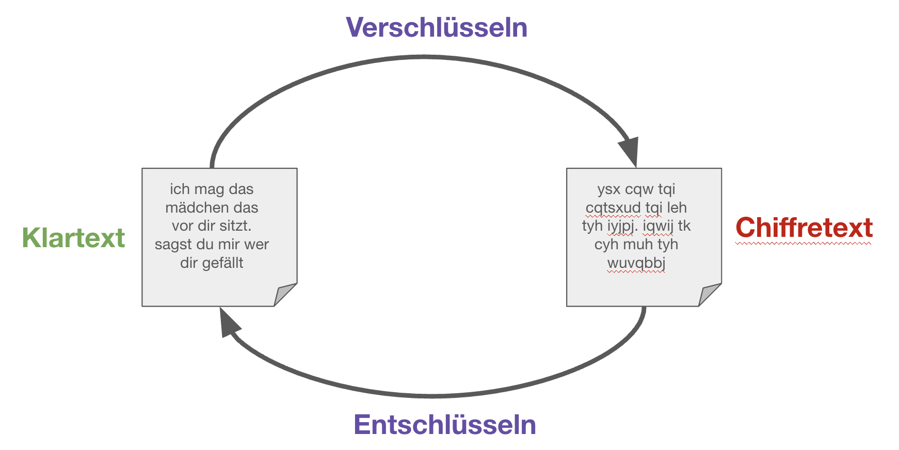

# a.  Analyse des Stoffs

Obwohl bei der professionelle Kryptopgrahie viel Mathematik als Vorwissen erwartet wird, dürfen wir die Gynmasiasten nicht überfordern. Wir stellen zuerst die Ideen die der Kryptographie vor: Wie kann man Geheimmitteilungen einander zusenden lassen.

Nach einem Beispiel vom Skytale, sowie auch der Gartenzaunverschlüsselung, kommen die zwei Hauptprozesse "Verschlüsselung" und "Entschlüsselung" ins Spiel. Bei der "Verschlüsselung", handelt es sich irgendeinen Text in eine Geheimnachricht zu verändern, und bei der "Entschlüsselung" kan man den Text wieder herstellen. Diese zwei Begriffe stehen auch in Relation zu "Klartext" und "Chiffretext", welches mit der Einführung zu Skytale und dem Gartenzaunverschlüsselung offenbar wird: Bei der Verschlüsselung nutzt man Klartext, bei der Entschlüsselung, den Chiffretext. All diese Begriffe sind wahrscheinlich neu für die Schüler, die möglicherweise noch nie eine Lektion in Kryptographie hatten. Da diese vier Wörter das Fundament der Kryptopgraphie bilden, lohnt es sich da noch ein Bild davon zu erstellen.

Da beide Methoden "Transposition" brauchen, wird diese Wort erklärt. Diese ist eine bestimmte Methode Daten zu verschlüsseln. 

Sobald diese paar Ideen eingeführt wurden, können sich die Schüler überlegen wie genau man Dinge entschlüsselt. Bei der Skytale und dem Gartenzaumverschlüsselung (sowie allen Transpositionsmethoden), ist es klar, dass man nur eine Wahl an Transpositionen hat: Sobald man den Trick kennt, ist der Sinn der Sache verloren, und somit, geht es zum Thema "Substitution", eine andere Art zu Verschlüsseln. Dabie wird hier nun zum ersten mal der "Schlüssel" wird beschrieben, was den Schülern zeigt, dass man mit einem "Shared Secret" Daten verschlüsseln kann. Dabei steht "Schlüssel" in direkter Relation zu "Verschlüsseln" und "Entschlüsseln". Bei Symmetrischen Kyptosystemen (die Systeme die wir unterrichten würden), ist dies der gleiche Schlüssel, weswegen wir den Metaphor gut nutzen können: Wie ein Schliessfach. 

Anstatt dass wir nun nur "eine" Möglichkeit hat wie man entschlüsselt\verschlüsselt, wie bei der Transposition, bietet die Caesarverschlüsselung mehrere Möglichkeiten an. Ohne dem Wissen von der Verschiebung können wir es nicht lesen. Aber wenn wir drauf beharren, können wir trotzdem den Klartext herausfinden, indem wir den Schlüssel mit einer Frequenzanalyse "finden". Man würde den Schülern vorzeigen wie man Caesar knacken kann, indem man die Anzahl Buchstaben zählt, und daraus die Verschiebung herausfinden kann. So ein Verfahren ist eine "Kryptanalyse", ein Prozess einen Chiffretext ohne Schlüssel in Klartext zu verwandeln. Da nun Schüler dies selber gemacht haben, ist die Caesarverschlüssung wenig nützlich, und es muss eine neue Methode entwickelt werden. Dieser Prozess nennt sich "Kryptographie". D.h. "Kryptographie" = neue Methoden entwicklen, "Kryptanalysis" = Versuchung den Code zu knacken.

Mit Caesar zu einfach, kann auch gezeigt werden dass alle Verschlüsselungen die nur einen Buchstaben mit einem anderen Ersetzen nicht gut genug ist. Darum würde man "monoalphabetische Substitution" mit "polyalphabetischer Substitution vergleichen, insbesondere mit dem Vignère Chiffre. Wieder kommt der Schlüssel vor, was dann zurück zur Kryptographie führt, und wiederum in die Kryptoanalyse.

...

# b. 
