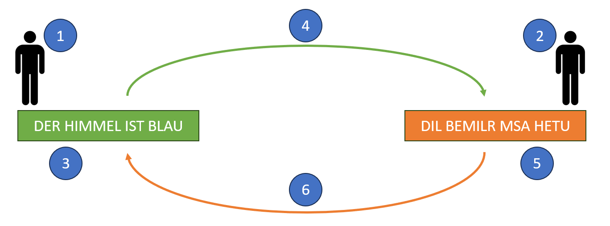

<!--
pandoc kapitel_1.md -o kapitel_1.pdf --pdf-engine=xelatex --lua-filter=encadres.lua
-->

# Einführung in die Kryptologie

## Einführung

Bevor wir ins Thema einsteigen, hören wir uns **UVB-76** an.

Der russische Radiosender UVB-76, oft «The Buzzer» genannt, ist eine geheimnisvolle Station, die seit Ende der 1970er-Jahre auf der Frequenz 4625 kHz sendet. Meist ist ein gleichmässiges Brummgeräusch zu hören. Nur selten wird es von russischen Sprachmeldungen mit Zahlen und codierten Wörtern unterbrochen. Viele vermuten eine Verbindung zum russischen Militär, etwa für die militärische Kommunikation oder ein Überwachungssystem. Die genaue Funktion wurde jedoch nie offiziell bestätigt. Deshalb gibt es zahlreiche Theorien darüber.

https://www.youtube.com/watch?v=ZAOVHbXdDoU

::: {.exercice}

**Fragen 1:**

- Welchen Vorteil bietet diese Technik, um im Krieg Nachrichten zu übermitteln?
- Welches Problem gibt es dabei?

**Antwort:**

Mit Funk lässt sich eine Nachricht schnell an mehrere weit entfernte Empfänger übermitteln, ohne vom Internet oder vom Telefonnetz abhängig zu sein. Im Krieg können diese Netze zerstört oder abgeschaltet werden. Auch ein Anbieter kann den Zugang einschränken.

Jede Person mit einem geeigneten Empfangsgerät kann die Übertragung mithören, auch der Gegner. Deshalb muss der **Inhalt der Nachricht verschlüsselt** werden, um ihre Vertraulichkeit zu schützen.

:::

In den **nächsten vier Lektionen** lernen wir verschiedene Methoden kennen und schauen dabei in die Geschichte zurück. Zunächst beschäftigen wir uns mit einfachen Methoden, bei denen die Buchstaben einer Nachricht umgeordnet werden. Das nennt man Transposition. Solche Verfahren wurden von spartanischen Kriegern verwendet. Anschliessend untersuchen wir, warum sie heute überholt sind.

Die Römer verwendeten andere Algorithmen, bei denen Buchstaben durch andere Buchstaben oder Symbole ersetzt wurden. Dieses Vorgehen nennt man Substitution.

Wir unterscheiden zwei Varianten: eine einfache und eine kompliziertere. Ausserdem untersuchen wir, wie sicher diese Verfahren sind, indem wir versuchen, aus den verschlüsselten Nachrichten den ursprünglichen Text zu rekonstruieren.

::: {.exercice}

**Frage 2:**

Warum ist es wichtig, den Inhalt einer persönlichen Nachricht auf WhatsApp zu schützen? Vor wem möchtet ihr ihn schützen?

**Antwort:**

Nur ihr und die Person, für die die Nachricht bestimmt ist, sollen sie lesen können. Die Verschlüsselung schützt den Inhalt vor Personen, die die Kommunikation abfangen könnten. So bleibt eure Privatsphäre geschützt, wenn ihr persönliche Informationen, Fotos oder vertrauliche Dokumente austauscht.

:::

*(Authentizität und Verfügbarkeit sind ebenfalls wichtige Begriffe der Informationssicherheit. Wir behandeln sie in dieser Unterrichtsreihe jedoch nicht.)*

::: {.exercice}

**Frage 3:**

Die ersten bekannten Beispiele für Schutzmechanismen sind etwa 3500 Jahre alt. Welche Art von Informationen wollte man eurer Meinung nach schützen?

1. Militärische Angriffspläne
2. Liebesbriefe
3. Rezepte für handwerkliche Herstellungsverfahren
4. Nachrichten zwischen Spionen
5. Informationen über versteckte Schätze

**Antwort:**

(3) Auch heute kennen wir alle Beispiele für Rezepte, die unbedingt geheim bleiben sollen :-).

Es geht bei der Sicherheit also nicht nur darum, eine Nachricht zu versenden, sondern darum, die Information insgesamt zu schützen.

:::

\newpage

## Operationale Lernziele

Nach dieser Lektion könnt ihr …

- erklären, warum Informationen während der Übertragung und bei der lokalen Speicherung geschützt werden müssen.
- die Begriffe Klartext, Geheimtext, Verschlüsselung und Entschlüsselung anhand eines Beispiels zuordnen.
- eine Nachricht nach einer vorgegebenen Transpositionsmethode ver- und entschlüsseln.
- erklären, dass eine Transposition die Reihenfolge der Buchstaben verändert, aber ihre Anzahl und Art beibehält.
- Methode und Schlüssel unterscheiden und beide in einem Beispiel benennen.
- dieselbe Methode mit unterschiedlichen Schlüsseln anwenden und die Ergebnisse vergleichen.
- das Kerckhoffs-Prinzip in eigenen Worten erklären und erkennen, wenn ein einfaches System dagegen verstösst.

\newpage

## Begriffe

Bevor wir weitermachen, klären wir einige Begriffe, die wir im weiteren Verlauf wieder verwenden.

1. Diese Person ist der **Absender**. Sie verschickt eine Nachricht.
2. Diese Person ist der **Empfänger**. Sie möchte die erhaltene Nachricht lesen können.
3. Die ursprüngliche, lesbare Nachricht heisst **Klartext**.
4. Der Vorgang, der den Inhalt der Nachricht verbirgt und sie unlesbar macht, heisst **Verschlüsselung**.
5. Die daraus entstandene Nachricht heisst **Geheimtext**.
6. Der Empfänger muss den Geheimtext wieder lesen können. Diesen Vorgang nennt man **Entschlüsselung**.

\newpage

## Kryptografie

Mit den Methoden zum Schutz von Informationen beschäftigt sich die **Kryptografie**. Sie entwickelt Verfahren und Algorithmen, mit denen Informationen geheim gehalten werden können.

::: {.exercice}

**Übung 1:**

Nehmt einen einfachen Satz wie «Der Himmel ist blau». Das ist unser **Klartext**, also die Nachricht, die wir übermitteln möchten.

Um das Beispiel zu vereinfachen, verwendet ihr nur Grossbuchstaben und entfernt die Leerzeichen. Schreibt den Text zeilenweise in die folgende Tabelle, von links nach rechts und von oben nach unten.

| | | | |
|:---:|:---:|:---:|:---:|
| | | | |
| | | | |
| | | | |
| | | | |

Lest die Tabelle nun spaltenweise von oben nach unten, beginnend mit der linken Spalte. Schreibt den so entstandenen Text auf ein Blatt Papier. Das ist euer **Geheimtext**.

Wir erhalten:

- Klartext: `DERHIMMELISTBLAU`
- Geheimtext: `DILBEMILRMSAHETU`

Die Anzahl der Buchstaben bleibt genau gleich.

Beantwortet zu zweit die folgenden Fragen:

- Haben wir Buchstaben hinzugefügt oder entfernt?
- Haben wir einen Buchstaben durch einen anderen ersetzt?
- Was hat sich verändert?

**Antwort:**

Die Buchstaben wurden lediglich **an andere Stellen verschoben**, ohne sie zu ersetzen. Genau das ist eine **Transpositionsverschlüsselung**: Wir nehmen einen Ausgangstext und verändern die Reihenfolge seiner Buchstaben.

:::

**Diskussion:**

Mit dieser Übung habt ihr das Prinzip der Transposition kennengelernt. Die Buchstaben einer Nachricht werden umgeordnet, aber nicht verändert.

Dabei spielen zwei Dinge eine wichtige Rolle:

1. Die **Methode** muss genau beschrieben sein. So weiss der Empfänger, wie die Nachricht verschlüsselt wurde und wie er die Schritte rückgängig machen kann.
2. Ein Parameter wird festgelegt und dem Empfänger mitgeteilt. Dieser Parameter heisst **Schlüssel**. Er ermöglicht es, die Nachricht mit der vereinbarten Methode zu entschlüsseln.

Behaltet diese beiden Begriffe im Kopf. Wir werden sie im weiteren Verlauf immer wieder brauchen.

::: {.exercice}

**Übung 2: Blöcke umordnen**

**Aufgabe:**

Ihr möchtet die Nachricht «Treffen um zwölf» (**TREFFENUMZWOELF**) übermitteln. Für die Verschlüsselung schreiben wir Ö als OE und lassen Leerzeichen weg. Diesmal verschiebt ihr ganze Buchstabenblöcke.

1. Teilt die Nachricht in drei Blöcke mit jeweils fünf Buchstaben und nummeriert sie von 1 bis 3.
2. Wählt eine neue Reihenfolge für die Blöcke. Diese Reihenfolge ist euer **Schlüssel**. Notiert ihn separat.
3. Setzt die Blöcke in dieser Reihenfolge zum Geheimtext zusammen.
4. Gebt einer anderen Gruppe den Geheimtext, die Methode und den Schlüssel. Kann sie die ursprüngliche Nachricht rekonstruieren?
5. Verschlüsselt die Nachricht nochmals mit einem anderen Schlüssel. Was verändert sich? Was bleibt gleich?

**Mögliche Antwort:**

Die drei Blöcke sind:

- Block 1: **TREFF**
- Block 2: **ENUMZ**
- Block 3: **WOELF**

**Methode:** Die Nachricht wird in Blöcke mit jeweils fünf Buchstaben aufgeteilt. Anschliessend werden die Blöcke in der Reihenfolge zusammengesetzt, die der Schlüssel vorgibt. Die Buchstaben innerhalb der Blöcke bleiben unverändert.

**Gewählter Schlüssel: 3-1-2.** Wir schreiben zuerst Block 3, dann Block 1 und schliesslich Block 2.

**Geheimtext: `WOELFTREFFENUMZ`.**

Zum Entschlüsseln teilen wir die empfangene Nachricht wieder in Blöcke mit jeweils fünf Buchstaben. Der Schlüssel zeigt uns: Der erste empfangene Block ist Block 3, der zweite ist Block 1 und der dritte ist Block 2. Wir bringen sie zurück in die Reihenfolge 1-2-3 und erhalten **TREFFENUMZWOELF**.

Mit einem anderen Schlüssel, **2-3-1**, erhalten wir **ENUMZWOELFTREFF**.

**Merkt euch: Die Methode legt fest, wie wir die Nachricht aufteilen und umordnen. Der Schlüssel bestimmt die Reihenfolge der Blöcke. Die Methode bleibt gleich, wenn sich der Schlüssel ändert.**

Diese Transposition lässt sich leicht knacken, denn bei drei Blöcken gibt es nur sechs mögliche Reihenfolgen.

:::

**Diskussion:**

Die beiden Übungen zeigen den Unterschied zwischen Methode und Schlüssel. Daraus ergibt sich eine Frage: Müssen wir zum Schutz einer Nachricht die ganze Methode geheim halten oder nur den Schlüssel?

Eine öffentliche Methode hat den Vorteil, dass viele Fachleute ihre Sicherheit überprüfen können. So lassen sich Schwächen leichter erkennen.

Ein wichtiger Grundsatz der Kryptografie besagt, dass ein System auch dann sicher bleiben muss, wenn die Methode öffentlich bekannt ist. Nur der Schlüssel muss geheim bleiben. Das ist das **Kerckhoffs-Prinzip**. Die wichtigsten Ideen sind:

1. Die Methode darf bekannt sein. Ihre Entdeckung darf die Sicherheit nicht gefährden.
2. Der Schlüssel muss geheim bleiben. Die Kenntnis der Methode allein darf nicht ausreichen, um die Nachricht zu lesen.
3. Der Schlüssel soll sich einfach ändern lassen, ohne die ganze Methode zu verändern.

::: {.exercice}

**Übung 3: eine geheime Methode**

Alice und Bob erfinden ein System: Sie schreiben alle Buchstaben ihrer Nachrichten in umgekehrter Reihenfolge. Sie halten diese Methode geheim und glauben, dass ihre Nachrichten dadurch geschützt sind.

Zum Beispiel wird aus HALLO der Text OLLAH.

**Frage:** Warum entspricht dieses System nicht dem Kerckhoffs-Prinzip? Was passiert, wenn jemand die Methode entdeckt?

**Antwort:**

Die Sicherheit beruht vollständig darauf, dass die Methode geheim bleibt. Sobald jemand sie kennt, kann diese Person alle Nachrichten lesen, indem sie die Reihenfolge der Buchstaben umkehrt. Es gibt keinen separaten geheimen Schlüssel, den man ändern könnte, ohne die Methode zu verändern.

:::

\newpage

## Zusammenfassung und Ausblick

In dieser Lektion haben wir gesehen, warum Informationen geschützt werden müssen: sowohl **während der Übertragung**, etwa per Funk oder über das Internet, als auch **bei der lokalen Speicherung** auf einem Computer oder Telefon. Eine Nachricht kann unterwegs abgefangen oder auf dem Gerät ohne Erlaubnis gelesen werden. Die Verschlüsselung soll ihre **Vertraulichkeit** schützen. Sie soll also verhindern, dass unbefugte Personen den Inhalt lesen können.

Das sind die wichtigsten Punkte:

- Der **Klartext** ist die ursprüngliche Nachricht. Durch die **Verschlüsselung** wird daraus der **Geheimtext**. Mit der **Entschlüsselung** gewinnt der Empfänger die ursprüngliche Nachricht zurück.
- Eine **Transposition** verändert nur die Reihenfolge der Buchstaben oder Buchstabenblöcke. Sie ersetzt keine Buchstaben und verändert ihre Anzahl nicht.
- Die **Methode**, auch Algorithmus genannt, beschreibt die Regeln. Der **Schlüssel** ist der gewählte Parameter, zum Beispiel die Reihenfolge der Blöcke. Der Schlüssel kann geändert werden, ohne die Methode zu verändern.
- Nach dem **Kerckhoffs-Prinzip** muss ein System auch dann sicher bleiben, wenn seine Methode bekannt ist. Der Schutz muss auf dem geheimen Schlüssel beruhen. Eine öffentliche Methode kann von anderen auf Schwächen untersucht werden. Das allein garantiert aber noch keine Sicherheit.

In der nächsten Lektion lernen wir konkrete Beispiele für Transpositionsverschlüsselungen kennen und untersuchen, wie sicher sie sind. Wir versuchen insbesondere, die ursprüngliche Nachricht ohne Kenntnis des Schlüssels zu rekonstruieren. So erkennen wir die Grenzen dieser Methoden. Die Untersuchung von Verfahren, mit denen sich aus einem Geheimtext die ursprüngliche Nachricht gewinnen lässt, nennt man **Kryptoanalyse**.

\newpage

## Übungen zur Lernkontrolle

Mit den folgenden Übungen könnt ihr überprüfen, was ihr gelernt habt.

::: {.exercice}

### Übung 1: Warum eine Nachricht schützen?

Alice schickt Bob über das Internet ein persönliches Dokument. Bob speichert es anschliessend auf seinem Computer.

1. Wann befindet sich das Dokument **in Übertragung**? Wann ist es **lokal gespeichert**?
2. Warum muss es in beiden Situationen geschützt werden?
3. Was bedeutet es, seine **Vertraulichkeit** zu schützen?

:::

::: {.exercice}

### Übung 2: eine Transposition anwenden

Ihr verwendet folgende Methode: Schreibt die Nachricht **zeilenweise** auf und lest sie danach **spaltenweise von oben nach unten, von links nach rechts**. Der Schlüssel ist die **Anzahl der Spalten**.

Klartext: **DASISTGEHEIM**

Schlüssel: **4 Spalten**

1. Erstellt die Tabelle und verschlüsselt die Nachricht.
2. Wiederholt die Aufgabe mit einem Schlüssel von **3 Spalten**.
3. Erklärt, was sich verändert und was gleich bleibt.
4. Warum handelt es sich um eine Transposition?

:::

::: {.exercice}

### Übung 3: eine entdeckte Methode

Alice und Bob verwenden eine Verschlüsselungsmethode mit einem geheimen Schlüssel. Ein Gegner entdeckt alle Regeln ihrer Methode.

1. Sollte diese Entdeckung ihm nach dem **Kerckhoffs-Prinzip** ermöglichen, ihre Nachrichten zu lesen? Begründet eure Antwort.
2. Welchen Vorteil kann eine öffentlich bekannte Methode haben?
3. Ihr System hat nur **sechs mögliche Schlüssel**. Wie könnte der Gegner die Nachricht rekonstruieren?
4. Wie nennt man die Untersuchung von Verfahren, mit denen sich eine Nachricht ohne Kenntnis des Schlüssels rekonstruieren lässt?

:::

\newpage

# Annexe: Gartenzaun Verschlüsselung

Wir werden einen Text mit der Gartenzaun Verschlüsselung verschlüsseln und entschlüsseln. Folge den angegebenen Schritten 

1. Wähle dir ein beliebiges vier Buchstaben langes Wort aus:

_________________________

___     ___     ___     ___

 2. Schreibe als nächstes einen kurzen Text:

_____________________________

3. Schreibe nun den Satz in den Gartenzaun rein. Fange dabei ganz links oben an, und schreibe die Buchstaben in jedes der Kästchen der Diagonale entlang:

4. Als nächstes, schreibe jede Zeile als einziges Wort. Dabei wirst du 4 Zeilen schreiben.

Zeile 1: _________________________

Zeile 2: _________________________

Zeile 3: _________________________

Zeile 4: _________________________

\newpage

5. Nun, nummerier die Buchstaben deines Schlüssels dem Alphabet nach unterhalb deines Schlüssels. Z. B. Wenn dein Wort “NAME” ist, dann ist die Nummerierung 4, 1, 3, 2, weil diese Buchstaben nacheinander im Alphabet vorkommen. Schreibe nun die Zeilen in dieser Reihenfolge als je ein Wort.

Geiheimtext: ________________________________________________________

Gratuliere! Du hast deine erste Verschlüsselung durchgeführt!

6. Schreib nochmals den Schlüssel hin:

_________________________

7. Gebe jetzt dieses Blatt an einen Mitschüler weiter, der die Nachricht lesen soll. Finde auch jemanden, der mit dir eine Nachricht teilen möchte. 

8. Zur Entschlüsselung, musst du die Buchstaben im Schlüssel so nummerieren wie sie im Alphabet vorkommen:

_________________________

___     ___     ___     ___

9. Schreibe nun die Wörter des Geheimtextes in der richtigen Reihenfolge. Achte dabei auf die Nummerierung: wenn du oben, z. B. In der zweiten Position eine 1 geschrieben hast, dann soll das zweite Wort als erstes geschrieben werden. 

 ________________________________________________________

10. Zu guter Letzt, schreibe nun die obigen Wörter horizontal in den Gartenzaun rein.

Wenn du alles richtig gemacht hast, kannst du nun den Geheimtext lesen, indem du diagonal die Buchstaben durchliest. 

Gratuliere! Nun kannst du an deinem Freund/Freundin Geheimnachrichten verschicken.
