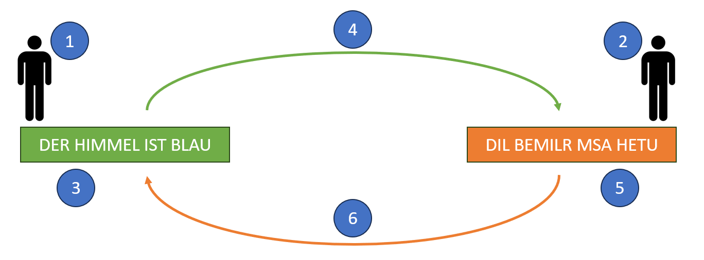
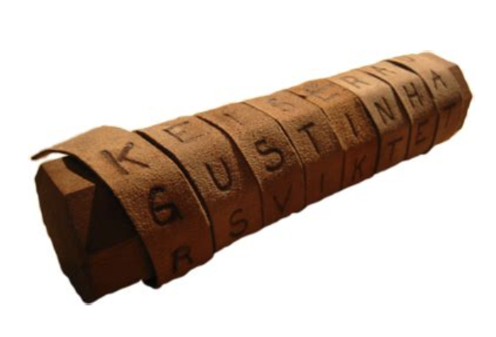
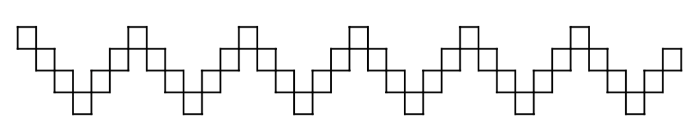

<!--
pandoc kapitel_2.md -o kapitel_2.pdf --pdf-engine=xelatex --lua-filter=encadres.lua
-->

# Transposition

## Rückblick auf die Einführung

Jetzt wo die Kryptographie eingeführt worden ist, stellt sich die Frage: Was für Arten von Transpositionen gibt es? Als erstes gehen wir nochmals durch die Begriffe die wir letztes mal gesehen haben:

Bevor wir weitermachen, klären wir einige Begriffe, die wir im weiteren Verlauf wieder verwenden.

Sie sollen nochmals die Wörter einorden:  **Absender**, **Empfänger**, **Klartext**, **Verschlüsselung**, **Geheimtext**, **Entschlüsselung**

Nun wird das Material der Transposition nochnmals angeschaut:

::: {.exercice}

**Fragen 1:**

- Was ist Transposition schon wieder (Dies sollte ein Enführungsaufgabe sein, das zurück an die vorherige Lektion erinnert)

:::

## Operationale Lernziele

Nach dieser Lektion könnt ihr

- Nachricht mit Skytale und dem Gartenzaun Algorithmus verschlüsseln und entschlüsseln
- Erklären was der Schlüssel ist für Skytale
- Verstehen wie man den Skytale entschlüsseln/knacken kann, ohne dem Schlüssel
- Den Ablauf vom Gartenzaun Algorithmus Schritt für Schritt durchführen
- Erklären welchen Einfluss die Länge des Passworts auf den endgültigen Geheimtext hat im Gartenzaun Algorithmus 
- Den ungefähr gebrauchten Zeitaufwand um einen Gartenzaun Geheimtext zu knacken

## Begriffe
- **Skytale**: ein Transpositionsalgoriothmus mit dem man Nachrichten verschlüsseln kann. Dabei nutzt man einen Stab, und ein Band. 
- **Gartenzaun**: ein Transpositionsalgoriothmus mit dem man Nachrichten verschlüsseln kann. Dafür braucht man nur etwas zum schreiben.
- **Schlüssel**: ein Informationsartefakt mit dem man verschlüsselte Nachrichten entschlüsseln kann. Skytale und Gartenzaun haben beide Schlüssel
- **Permutation**: eine bestimmte Reihenfolge von vielen potenziellen Reihenfolgen. Schlüssel sind oft eine bestimmte Permutation (Wahl an Reihenfolge), die, wegen der grossen Zahl an potenziellen Reihenfolgen nicht erraten werden kann.
- **Sprache**: Die Sprache in dem ein Klartext geschrieben 

Die Art von Transposition braucht viel Papier und Vorsicht, zum einen mal es zu verschlüsseln und entschlüsseln. Vor 2500 Jahren aber, gab es sehr wenig Papier und etwas zu schreiben, was auch der Grund ist warum die meisten Menschen damals dies nie gelernt haben. Für die Leute die lesen und schreiben konnten, waren typischerweise reiche Leute sowie Politiker oder Generale. 

Um dem Militär Weisungen zu geben, nutzte man etwas namens ein Skytale, um Nachrichten zu verschlüsseln. Diese Technologie bestand aus einem **Stock**, und einem **Band**, was viel gänger war. Damit konnte man verschlüsselte Nachrichten verschicken, ohne dass andere Leute die Nachricht lesen konnten. Wir werden genau diesen Prozess durchführen, aber nur mit unseren Bleistiften und ein wenig Papier. Dabei werdet ihr euren Klartext auswählen den ihr verschlüsseln wollt, werdet ihn anschliessend in Geheimtext umwandeln, und ihn an einen Freund "schicken". 

<!-- 
**Material:**
 mit verschlüsseltem Text. Der Lehrer sollte auch dabei einen grossen Stab mitbringen (oder einen langen Holzblock), sowie auch ein Band (aus Ducktape und Quadratischen Papier z. B.) um Ihnen zu zeigen wie Skytale funktioniert. Weitern, sollen Streifen ausgedruckt werden die Geheimtext enthalten, die mit Stiften entschlüsselt werden können.  -->

::: {.exercice}

**Auftrag:** 

# Teil 1
Gegeben wird Ihnen ein Geheimtext. Sie sollen mit Hilfe von Stiften und lange Papierbänden selber probieren herauszufinden wie man einen Geheimtext auf langen Streifen Papier, geschrieben mit Hilfe von Skytale, entschlüsselt. Sie sollen auch lernen wie man Geheimtext selber verschlüsselt.

# Teil 2
Nun wird ein neuer Streifen Text gegeben. Dieser soll auch entschlüsselt werden, jedoch, kann man dies nicht mit nur Bleistiften machen. Der Trick dafür, ist dass man den Streifen um zwei Bleistfte wickeln muss. 

:::

::: {.exercice}

**Fragen 2:**
- Wie kann man die Nachricht entschlüsseln?

**Antwort:** 

Der Geheimtext kann entschlüsselt werden indem man den Streifen Papier mit dem Text um den Stift wickelt. Dann kann man den Text Zeile für Zeile lesen

:::

::: {.exercice}

**Fragen 3:**
- Was ist der Schlüssel um die Nachricht zu entschlüsseln?

**Antwort:** 

Der Schlüssel beinhaltet nur die Dicke des Stabes. Um genau zu sein, ist es der Umfang der definiert was der Schlüssel ist. Das heisst, dass der Schlüssel ein Stab ist mit dem gleichen Umfang, auch den der Stab möglicherweise dünner oder dicker ist.

:::

::: {.exercice}

**Fragen 4:**
- Ist dies ein guter Schlüssel? Warum, warum nicht?

**Antwort:** 

Da Stäbe, in praktischer Hinsicht, keinen shr grossen Umfang haben können, ist die Transposition auch beeinträchtigt: Es können nur bestimmte Werte genutzt werden, die die Transposition definiert. 

:::

Es stellt sich heraus, dass diese Methode doch nicht sehr gut ist, da mit dieser Methode man alle Buchstaben um die gleiche Anzahl Buchstaben verschieben muss. Wir, innerhalb von ein paar Minuten haben herausgefunden wie man das macht, auch wenn ich euch gesagt habe, dass der Stift wichtig ist beim Entschlüsseln des Textes.

Bei der Transposition handelt es sich ja nur um das Verschieben von Buchstaben, wobei das Verschieben irgendwie durch ein Schlüssel verriegelt sein soll. Aber, es heisst nicht dass wir alle Buchstaben gleich verschieben müssen. Beim Skytale, ist das eben genau der Fall. Das heisst, dass der Schlüssel typischerweise nur eine kleine Zahl ist, wie z. B. 5. Nun würden wir, mit Hilfe vom Zigzagschreiben die Buchstabenverschiebung vertuschen. 

**Kurze Vorstellung der Idee**. 

Der Gartenzaun Algorithmus beginnt mit einer Verschiebung, beinhaltet jedoch den letzten Teil, wo man ein Passwort wählen soll. Dabei wird zuerst der erste Schritt gezeigt, wie man den Klartext schreiben würde, und daraus einen Geheimtext extrahieren würde. (noch soll kein Passwort genutzt werden). 

::: {.exercice}

**Fragen 5:**
- Wie sieht es nun mit der Verschiebung aus?

**Antwort:** 

Nun werden einige Buchstaben um eine Zahl verschoben, andere um eine andere Zahl

- Was ist der "Schlüssel" hier? 

**Antwort:** 

Der Schlüssel ist jetzt die Dicke des Gartenzauns, der die Verschiebung der Buchstaben definiert

:::

Es stellt sich heraus, dass man jetzt nichts weiteres wissen muss, um den Code zu knacken, lediglich die Grösse des Zauns. Im Moment, kann jeder jede Nachricht mit ein wenig Zeit knacken, sodass wir keine Nachrichten schicken können damit sie sicherlich geheim bleiben. Nun soll noch die Reihenfolge der verschiedenen Zeilen auch noch gemischt werden, anhand von einer **Permutation**. 

Diese Methode wird ihnen vorgestellt, und es wird ihnen gezeigt wie man so einen Schlüssel nutzen kann. Mit Hilfe vom PDF, sollen die Schüler einen Freund/in holen, ihre Schlüssel austauschen, und einander Nachrichten schreiben. Dabei brauchen sie nur die Vorlage die ihnen gegeben wird. 

::: {.exercice}

**Fragen 6:**
- Was braucht es, damit man den Code von anderen knacken kann?

**Antwort:** 

Es braucht nun den Schlüssel (das **Passwort**) um den Geheimtext in Klartext umzuwandeln. Obwohl die Länge des Passworts eindeutig ist, gibt es viele verschiedene Reiheinfolgen die benutzt werden können. Darum ist es auch schwer den Code von anderen zu entschlüsseln.  

:::

Es folgt eine kurze Diskussion über welches dieser Methoden besser ist als die andere. Abei kann man folgendes erwähnen

- Die Art der Schlüssel (physischer oder wörtlicher)
- Dauer zum Verschlüsseln, Entschlüsseln
- Dauer es ohne den Schlüssel zu knacken
- **Das egal was der Schlüssel und was die Transpositionsmethode ist, sind alle Buchstaben die genutzt werden im Geiheimtext drin**

## Zusammenfassung und Ausblick

Mit Transpositions Methoden ist es immer der Fall, dass alle genutzten buchstaben vorhanden ist. Das heisst, das wenn jemand gut mit **Anagrammen** arbeiten kann, können kurze Nachrichten geknackt werden, inbesondere **wenn man einen bestimmten Text erwartet**, wie z. B. wenn im Geiheimtext der Buchstabe **ü** vorkommt, und man inen Stadtnamen erwartet, kann es sein das die Stadt "Zürich" erwähnt wird. 

Um dies zu vertuschen, braucht es eine neue Methode, nämlich die **Substitution**, umd Buchstaben in anere Buchstaben umzuwandeln. Dies hat auch seine Schwächen, aber, die werden in der nächsten Lektion angesprochen.

# Übungen zur Lernkontrolle

::: {.exercice}

## Übung 1

Nimm an du hast die folgenden Geheimtexte vor dir: 

1. `opgewrseimkriomezunnusngdrekaihe`
2. `ttyxyxyvfjcispycgillnfkulurvenvu`

welches dieser Geheimtexte höchstwahrschienlich kein Text der mit Hilfe von der Transpositions Methode geschrieben wurde?

**Antwort**: 2. Der zweite Geheimtext hat viele **x** Buchstaben, sowie auch drei **y**. Diese Buchstaben kommen in der Detuschen und andere Lateinbasierenden Sprachen kaum vor. Weiterhin gibt es 

:::

::: {.exercice}

## Übung 2

Nehmen wir an, wir haben einen Klartext, den wir mit der Skytale verschlüsseln. Mit diesem Geheimtext, verschlüsseln wir ihn nun mit dem Gartenzaun Algorithmus, und bekommen einen neuen Geheimtext. Ist dieser Geheimtext schwieriger zu knacken als wenn man nur einen der Algorhtmen nutzt? Warum?

**Antwort**: Ja. In dieser neuen Methode müssel wir zwei Schlüssel wissen um den Algorithmus zu knacken. Obwohl wir für Skytale nur ein paar realistische Zahlen als Schlüssel haben können, ist es unmöglich zu wissen welches dieser Zahlen richtig ist ohne den Schlüssel zum Gartenzaun zu haben. Somit kann Schlüssel mehrere Werte haben, und darum ist der Algorithmus schwerer zu knacken. Man muss sich aber auch einen längeren Schlüssel merken.

:::

::: {.exercice}

## Übung 3: Herausforderung

Sagen wir, wir möchten Skytale als Verschlüsselungs Methode einführen. Wir möchten gerne aber den Schlüssel frei wählen, anstatt dass wir einen bestimmten Stab nutzen. Jedoch, sollte der Stab rund sein. Wenn unsere Buchstaben 4cm gross sind, und unser Schlüssel 7 sein sollte, was sollte der Durchmesser des Stabes sein?

**Antwort**: 

Da jeder Buchstabe auf den Stab projiziert sein soll, heisst das, dass der Umfang des Kreises 4cm * 7 = 28cm sein sollte. Wir wissen auch, dass der Umfang eines Kreises `Umfang eines Kreises = Durchmesser * pi` ist. Wenn wir nun fü den Durchmesser lösen, haben wir `(Umfang eines Kreises) / pi = Durchmesser`. Wenn wir unsere Zahlen reintun, bekommen wir `28cm / pi = 8.9cm`.

:::

\newpage

## Gartenzaun Verschlüsselung

Wir werden einen Text mit der Gartenzaun Verschlüsselung verschlüsseln und entschlüsseln. Folge den angegebenen Schritten 

1. Wähle dir ein beliebiges vier Buchstaben langes Wort aus:

_________________________

___     ___     ___     ___

 2. Schreibe als nächstes einen kurzen Text:

_____________________________

3. Schreibe nun den Satz in den Gartenzaun rein. Fange dabei ganz links oben an, und schreibe die Buchstaben in jedes der Kästchen der Diagonale entlang:

4. Als nächstes, schreibe jede Zeile als einziges Wort. Dabei wirst du 4 Zeilen schreiben.

Zeile 1: _________________________

Zeile 2: _________________________

Zeile 3: _________________________

Zeile 4: _________________________

\newpage

5. Nun, nummerier die Buchstaben deines Schlüssels dem Alphabet nach unterhalb deines Schlüssels. Z. B. Wenn dein Wort “NAME” ist, dann ist die Nummerierung 4, 1, 3, 2, weil diese Buchstaben nacheinander im Alphabet vorkommen. Schreibe nun die Zeilen in dieser Reihenfolge als je ein Wort.

Geiheimtext: ________________________________________________________

Gratuliere! Du hast deine erste Verschlüsselung durchgeführt!

6. Schreib nochmals den Schlüssel hin:

_________________________

7. Gebe jetzt dieses Blatt an einen Mitschüler weiter, der die Nachricht lesen soll. Finde auch jemanden, der mit dir eine Nachricht teilen möchte. 

8. Zur Entschlüsselung, musst du die Buchstaben im Schlüssel so nummerieren wie sie im Alphabet vorkommen:

_________________________

___     ___     ___     ___

9. Schreibe nun die Wörter des Geheimtextes in der richtigen Reihenfolge. Achte dabei auf die Nummerierung: wenn du oben, z. B. In der zweiten Position eine 1 geschrieben hast, dann soll das zweite Wort als erstes geschrieben werden. 

 ________________________________________________________

10. Zu guter Letzt, schreibe nun die obigen Wörter horizontal in den Gartenzaun rein.

Wenn du alles richtig gemacht hast, kannst du nun den Geheimtext lesen, indem du diagonal die Buchstaben durchliest. 

Gratuliere! Nun kannst du an deinem Freund/Freundin Geheimnachrichten verschicken.

