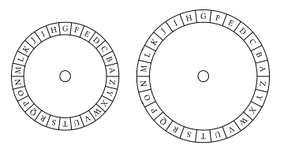
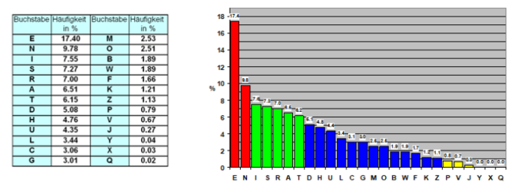
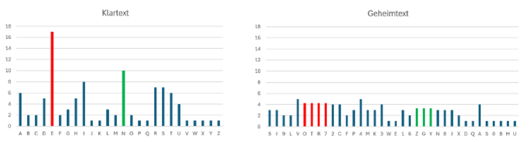
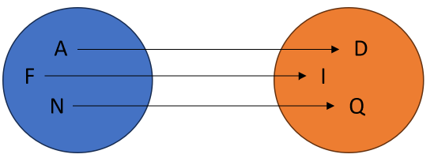
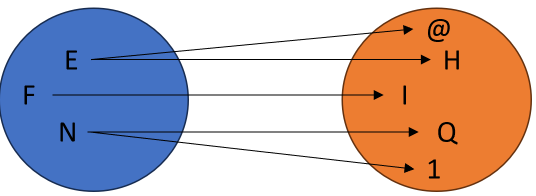

<!--
pandoc a3_einfuhrung_de.md -o a3.pdf --pdf-engine=xelatex --lua-filter=encadres.lua
-->

# Substitution – Einführung

## Einführung

In der letzten Lektion habt ihr gelernt, wie Transpositionsverfahren funktionieren und welche Probleme sie mit sich bringen.

Schauen wir nun, wie sich die Kryptografie weiterentwickelt hat.

::: {.exercice}

**Übung 1**

Julius Caesar könnte ein Hilfsmittel wie das folgende verwendet haben, um seine Briefe zu verschlüsseln. Schneidet die beiden Scheiben aus und verbindet sie in der Mitte.

Nehmt den Satz «Der Himmel ist blau»: `DERHIMMELISTBLAU`.

Beantwortet zu zweit die folgenden Fragen:

- Wie könnt ihr die Nachricht mit diesen beiden Scheiben verschlüsseln?
- Was ist die Methode? Nach dem Kerckhoffs-Prinzip darf sie bekannt sein.
- Was ist der Schlüssel, der geheim bleiben muss?
- Handelt es sich um eine Transposition, wie ihr sie in den vorherigen Lektionen kennengelernt habt?

**Antwort:**

- Wir verschieben die Buchstaben im Alphabet.
- Die Methode besteht darin, jeden Buchstaben um dieselbe Anzahl von Stellen zu verschieben. Die Scheiben helfen uns dabei.
- Der Schlüssel ist die Anzahl der Stellen. Bei einem Schlüssel von 3 wird zum Beispiel aus `A` ein `D`.
- Nein. Die Buchstaben werden nicht umgeordnet, sondern durch andere Buchstaben ersetzt.

:::

**Diskussion:**

Mit dieser Übung habt ihr die Grundidee der Caesar-Verschlüsselung kennengelernt. Caesar selbst verwendete eine Verschiebung um drei Stellen, um seine Briefe zu verschlüsseln.

\newpage

## Substitution

In den ersten Kapiteln haben wir verschiedene Transpositionsverfahren kennengelernt. Dabei wurden die Buchstaben nach bestimmten Regeln umgeordnet, etwa bei der Skytale oder beim Gartenzaun-Verfahren.

Bei Caesar **ersetzen wir die Buchstaben**, indem wir sie im Alphabet verschieben. Dieses Ersetzen nennt man **Substitution**. Caesar verwendete der Überlieferung nach eine Verschiebung um `3` Stellen, also einen **Schlüssel von `3`**. Die Bezeichnungen **ROT3** und **ROT13** stehen entsprechend für eine Verschiebung um `3` beziehungsweise `13` Stellen.

Wir können dieselbe Methode auch mit dem Schlüssel `13` verwenden. Hier begegnet uns wieder die Unterscheidung aus dem Kerckhoffs-Prinzip: Der Schlüssel muss geheim bleiben und kann geändert werden, ohne die Methode zu verändern.

::: {.exercice}

**Frage 1:**

Verwendet die Caesar-Verschlüsselung mit dem Schlüssel `5`.

- Durch welchen Buchstaben wird `B` ersetzt?
- Durch welchen Buchstaben wird `U` ersetzt?

Beantwortet dieselben Fragen mit dem Schlüssel `13`.

**Antwort:**

| Verschiebung | Klartextbuchstabe | Geheimtextbuchstabe |
|---|---|---|
| 5 | B | G |
| 5 | U | Z |
| 13 | B | O |
| 13 | U | H |

**Frage 2:**

Entschlüsselt den folgenden Text mit `ROT3`:

`KDQQLEDOQDHKHUWVLFKURPPLWGUHLVVLJHOHSKDQWHQ`

**Antwort:**

`HANNIBALNAEHERTSICHROMMITDREISSIGELEPHANTEN`

:::

\newpage

## Einführung in die Häufigkeitsanalyse

Bei den bisher betrachteten Substitutionsverfahren steht derselbe Buchstabe im Geheimtext immer für denselben Buchstaben im Klartext. Schaut euch nochmals das Beispiel aus Frage 2 an:

- `KDQQLEDOQDHKHUWVLFKURPPLWGUHLVVLJHOHSKDQWHQ` → Geheimtext
- `HANNIBALNAEHERTSICHROMMITDREISSIGELEPHANTEN` → Klartext

Wir können Folgendes beobachten:

- `K` steht immer für `H`.
- `Q` steht immer für `N`.
- `H` steht immer für `E`.

::: {.exercice}

**Frage 3:**

Der Buchstabe `E` ist der häufigste Buchstabe der deutschen Sprache. Welche Schwäche ergibt sich daraus für diese Substitutionsverfahren?

**Antwort:**

*Siehe Diskussion.*

:::

**Diskussion:**

Wir können die Häufigkeit einzelner Buchstaben untersuchen, aber auch die von **Digrammen** (zwei aufeinanderfolgenden Buchstaben) und **Trigrammen** (drei aufeinanderfolgenden Buchstaben).

In deutschen Texten kommt `E` beispielsweise mit einer Häufigkeit von etwa `17 %` vor, `Q` dagegen nur mit etwa `0,02 %`. Das Digramm `EN` hat eine Häufigkeit von etwa `3,88 %`.

Wenn der Geheimtext lang genug ist, können wir den häufigsten Buchstaben bestimmen. Es ist gut möglich, dass er im ursprünglichen Text einem `E` entspricht. So suchen wir nach und nach weitere Zuordnungen, bis wir die Buchstaben entschlüsselt haben.

In der Kryptoanalyse nennt man dieses Vorgehen **Häufigkeitsanalyse**. Die folgende Grafik zeigt die Verteilung der Buchstaben in der deutschen Sprache.

Wichtig ist, dass sich diese Analyse auf **eine bestimmte Sprache** bezieht, in diesem Fall auf Deutsch. Bei einer anderen Sprache sind die Buchstaben anders verteilt. Deshalb muss auch die Analyse angepasst werden.

Mit modernen Computern lassen sich solche Untersuchungen sehr schnell durchführen. Diese einfachen Verschlüsselungsverfahren sind deshalb heute überholt.

::: {.exercice}

**Übung 3:**

Verbinden wir die beiden bisherigen Konzepte. Der folgende Text wurde mit der Caesar-Methode verschlüsselt. Die Verschiebung ist unbekannt. Findet den Schlüssel mithilfe einer Häufigkeitsanalyse und knackt den Code.

`ILYLPAZLPULPUGPNLYIBJOZAHILYLPJOAHBZBTKPLJHLZHYCLYZJOSBLZZLSBUNGBRUHJRLU`

**Antwort:**

Der Buchstabe `L` kommt mit 13 Vorkommen am häufigsten vor. Da `E` im Deutschen normalerweise der häufigste Buchstabe ist, können wir vermuten, dass `E` zu `L` verschlüsselt wurde.

Von `E` bis `L` sind es sieben Stellen. Der vermutete Schlüssel ist also 7. Verschieben wir jeden Buchstaben um sieben Stellen zurück, erhalten wir:

`BEREITSEINEINZIGERBUCHSTABEREICHTAUSUMDIECAESARVERSCHLUESSELUNGZUKNACKEN`

Mit Leerzeichen:

«Bereits ein einziger Buchstabe reicht aus, um die Caesarverschlüsselung zu knacken.»

Diese Methode bietet also keinen ausreichenden Schutz. Die Häufigkeitsanalyse liefert zunächst eine Vermutung. Der verständliche deutsche Text bestätigt anschliessend den Schlüssel.

:::

\newpage

## Ein Lösungsansatz

Ein Ansatz, um diese Analyse zu erschweren, besteht darin, die Häufigkeiten der Symbole gleichmässiger zu verteilen. Dadurch wird es schwieriger, die häufigsten Klartextbuchstaben zu erkennen.

Betrachtet die folgende Verteilung: Links seht ihr den Klartext, in dem `E` am häufigsten vorkommt. Rechts seht ihr den Geheimtext mit einer ausgeglicheneren Verteilung. Allein anhand der Häufigkeiten lässt sich `E` nun schwerer erkennen.

Dafür müssen wir unser Geheimtextalphabet erweitern. Ein Klartextbuchstabe kann dann durch mehrere verschiedene Zeichen verschlüsselt werden. Im Beispiel oben sehen wir:

- Das ursprüngliche `E` kann als `O`, `T`, `R` oder `7` erscheinen.
- Das ursprüngliche `N` kann als `Z`, `G` oder `Y` erscheinen.

Das nennt man **homophone Substitution**. «Homophon» bedeutet hier, dass verschiedene Zeichen im Geheimtext für denselben Buchstaben im Klartext stehen können.

\newpage

## Verschiedene Alphabete

Merkt euch die Unterscheidung zwischen zwei Alphabeten:

- Das **Klartextalphabet**, auch Basisalphabet genannt, enthält die Buchstaben, mit denen wir die ursprüngliche Nachricht schreiben. Es wird durch den blauen Kreis dargestellt.
- Das **Geheimtextalphabet**, auch Zielalphabet genannt, enthält die Zeichen, mit denen wir die Nachricht verschlüsseln. Es wird durch den orangefarbenen Kreis dargestellt.

Für eine Caesar-Verschlüsselung mit dem Schlüssel `3` sieht das so aus:

Bei einer homophonen Substitution ist das Geheimtextalphabet grösser als das Klartextalphabet, weil bestimmte Buchstaben durch mehrere verschiedene Zeichen dargestellt werden können.

::: {.exercice}

**Übung:**

Bei einer **homophonen Verschlüsselung** kann ein Buchstabe des Klartextalphabets mehreren Symbolen des Geheimtextalphabets entsprechen.

| Klartextalphabet (Basisalphabet) | Geheimtextalphabet (Zielalphabet) |
|---|---|
| E | 11, 24, 37 |
| G | 42 |
| H | 53 |
| I | 16, 68 |
| M | 75 |
| N | 29, 84 |
| S | 93 |

**Regel:** Hat ein Buchstabe mehrere Symbole, verwendet ihr sie abwechselnd in der Reihenfolge der Tabelle. Beginnt bei jeder neuen Nachricht wieder mit dem ersten Symbol. Trennt die Zahlen durch Leerzeichen.

1. Verschlüsselt die Nachricht **GEHEIMNIS**.
2. Entschlüsselt die Nachricht: **75 11 16 29 42 24 53 37 68 75 84 16 93**.
3. Verschlüsselt **EEEEEE**. Wie oft kommt jedes Symbol vor?
4. Erklärt, warum diese Methode die Häufigkeitsanalyse erschwert.
5. Bestimmt **die Methode** und **den Schlüssel**.

**Antwort:**

1. `42 11 53 24 16 75 29 68 93`
2. `MEINGEHEIMNIS` – «MEIN GEHEIMNIS».
3. `11 24 37 11 24 37`. Jedes Symbol kommt **zweimal** vor, während der Buchstabe E in der ursprünglichen Nachricht sechsmal vorkommt.
4. Die Vorkommen desselben Buchstabens verteilen sich auf mehrere Symbole. Für E gibt es also nicht mehr nur ein einziges, besonders häufiges Symbol. Das erschwert die Häufigkeitsanalyse, macht das System aber nicht unknackbar.
5. Die beiden Begriffe lassen sich so unterscheiden:

   - **Methode:** Jeden Buchstaben durch eines seiner Symbole ersetzen und dabei nach der vorgegebenen Regel zwischen den Symbolen wechseln.
   - **Schlüssel:** Die Zuordnungstabelle zwischen Klartextalphabet und Geheimtextalphabet.

:::

\newpage

## Zusammenfassung und Ausblick

In dieser Lektion haben wir die **Substitution** kennengelernt. Anders als die Transposition, die Buchstaben verschiebt, ersetzt sie die Buchstaben des Klartexts durch andere Buchstaben oder Symbole.

Diese Begriffe solltet ihr euch merken:

- Die **Caesar-Verschlüsselung** ist eine Substitution, bei der jeder Buchstabe um dieselbe Anzahl von Stellen im Alphabet verschoben wird. Der **Schlüssel** ist die Anzahl der Stellen, zum Beispiel 3. Bei einer Verschiebung um `3` nennt man das Verfahren auch `ROT3`.
- Das **Klartextalphabet** oder Basisalphabet enthält die Buchstaben der ursprünglichen Nachricht. Das **Geheimtextalphabet** oder Zielalphabet enthält die Buchstaben oder Symbole, mit denen die verschlüsselte Nachricht dargestellt wird.
- Bei einer **einfachen monoalphabetischen Substitution** wird jeder Klartextbuchstabe immer durch denselben Geheimtextbuchstaben oder dasselbe Symbol ersetzt. Die Häufigkeiten bleiben deshalb erhalten, sind aber anderen Buchstaben oder Symbolen zugeordnet.
- Die **Häufigkeitsanalyse** zählt Buchstaben oder Buchstabengruppen im Geheimtext und vergleicht ihre Verteilung mit derjenigen der vermuteten Sprache. Daraus lassen sich mögliche Zuordnungen ableiten. Anschliessend prüft man, ob ein verständlicher Text entsteht.
- Die **Kryptoanalyse** untersucht, wie sich aus einem Geheimtext die ursprüngliche Nachricht oder der Schlüssel gewinnen lässt, ohne den Schlüssel vorher zu kennen. Die Häufigkeitsanalyse ist eine ihrer Methoden.
- Bei einer **homophonen Substitution** kann ein Klartextbuchstabe durch mehrere verschiedene Geheimtextsymbole dargestellt werden. Jedes dieser Symbole steht jedoch für genau einen Klartextbuchstaben. Die Vorkommen häufiger Buchstaben verteilen sich so auf mehrere Symbole. Dadurch wird die Häufigkeitsanalyse erschwert.

Wir haben auch den Unterschied zwischen **Methode** und **Schlüssel** wieder aufgegriffen: Die Methode beschreibt die Regeln des Ersetzens. Der Schlüssel legt die konkreten Zuordnungen oder die Verschiebung fest.

In der nächsten Lektion verwenden wir nicht mehr nur ein einziges Zielalphabet, sondern **mehrere Geheimtextalphabete**. Welches Alphabet jeweils verwendet wird, bestimmt ein Schlüssel. Das ist das Prinzip der **polyalphabetischen Substitution**, das wir anhand der **Vigenère-Verschlüsselung** kennenlernen werden. Derselbe Klartextbuchstabe kann dann je nach seiner Position in der Nachricht unterschiedlich verschlüsselt werden.

\newpage

## Übungen zur Lernkontrolle

### 1. Von Buchstaben zu Uhrzeiten

Alice und Bob ersetzen jeden Buchstaben durch eine Uhrzeit aus der folgenden Tabelle. Jede Uhrzeit steht für genau einen Buchstaben. Die Leerzeichen zwischen den Wörtern bleiben erhalten.

| Buchstabe | Uhrzeit | Buchstabe | Uhrzeit |
|---|---|---|---|
| A | 08:00 | N | 07:00 |
| B | 15:00 | O | 14:00 |
| C | 22:00 | P | 21:00 |
| D | 05:00 | Q | 04:00 |
| E | 12:00 | R | 11:00 |
| F | 19:00 | S | 18:00 |
| G | 02:00 | T | 01:00 |
| H | 09:00 | U | 08:30 |
| I | 16:00 | V | 15:30 |
| J | 23:00 | W | 22:30 |
| K | 06:00 | X | 05:30 |
| L | 13:00 | Y | 12:30 |
| M | 20:00 | Z | 19:30 |

**Fragen:**

1. Verschlüsselt das Wort **GEHEIM**.
2. Entschlüsselt die Nachricht: **09:00 – 08:00 – 13:00 – 13:00 – 14:00**.
3. Was ist das **Klartextalphabet** beziehungsweise Basisalphabet?
4. Was ist das **Geheimtextalphabet** beziehungsweise Zielalphabet?
5. Warum handelt es sich um eine **Substitution** und nicht um eine Transposition?
6. Was ist die verwendete **Methode**?
7. Was ist der **Schlüssel**? Wie könntet ihr den Schlüssel ändern, ohne die Methode zu verändern?

### 2. Den Schlüssel ändern, um die Häufigkeitsanalyse zu erschweren

In der ersten Tabelle wird ein Buchstabe immer durch dieselbe Uhrzeit ersetzt. Ein häufiger Buchstabe wie **E** führt deshalb zu einer häufigen Uhrzeit im Geheimtext.

Alice und Bob möchten diese Analyse erschweren. Sie ändern ihre Tabelle: Bestimmte Buchstaben können nun durch **mehrere verschiedene Uhrzeiten** ersetzt werden.

**Auftrag:** Erstellt eine neue Tabelle für die Buchstaben **E, G, H, I und M**. Ordnet **E** drei Uhrzeiten zu, **I** zwei Uhrzeiten und jedem der anderen Buchstaben eine Uhrzeit. Jede Uhrzeit darf nur für einen einzigen Buchstaben stehen.

Beginnt bei jeder neuen Nachricht wieder mit dem ersten Symbol.

**Fragen:**

1. Verschlüsselt mit eurer neuen Tabelle zuerst **GEHEIM** und dann **EEEEEE**.
2. Wie oft kommt jede Uhrzeit bei der Verschlüsselung von **EEEEEE** vor? Vergleicht das Ergebnis mit der ersten Übung.
3. Warum sollte man häufigen Buchstaben mehrere Uhrzeiten zuordnen und seltenen Buchstaben weniger?
4. Wie nennt man diese Art der Substitution?
5. Habt ihr nur den **Schlüssel** geändert oder auch die **Methode** angepasst? Vergleicht die Regeln beider Übungen und begründet eure Antwort.
6. Reicht diese Änderung aus, um die Sicherheit der Nachricht zu garantieren? Erklärt eure Antwort.
