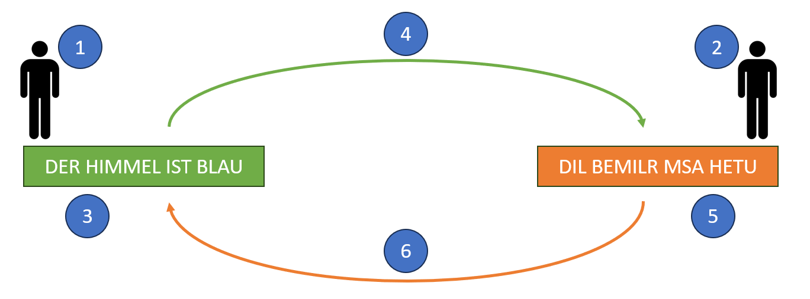
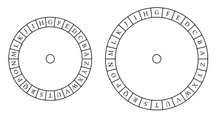
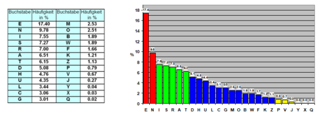
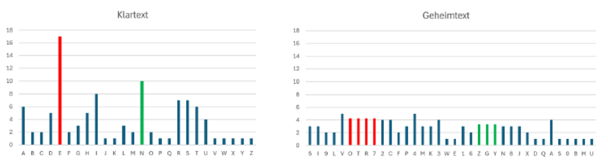
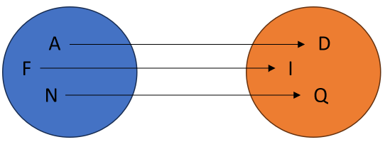
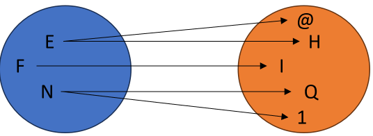
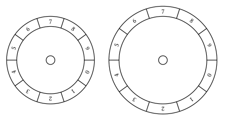

<!--
pandoc kapitel_all.md -o kapitel_all.pdf --pdf-engine=xelatex --lua-filter=encadres.lua --toc --toc-depth=3 --number-sections
-->

\newpage

# Einführung in die Kryptologie

## Einführung

Bevor wir ins Thema einsteigen, hören wir uns **UVB-76** an.

Der russische Radiosender UVB-76, oft «The Buzzer» genannt, ist eine geheimnisvolle Station, die seit Ende der 1970er-Jahre auf der Frequenz 4625 kHz sendet. Meist ist ein gleichmässiges Brummgeräusch zu hören. Nur selten wird es von russischen Sprachmeldungen mit Zahlen und codierten Wörtern unterbrochen. Viele vermuten eine Verbindung zum russischen Militär, etwa für die militärische Kommunikation oder ein Überwachungssystem. Die genaue Funktion wurde jedoch nie offiziell bestätigt. Deshalb gibt es zahlreiche Theorien darüber.

https://www.youtube.com/watch?v=ZAOVHbXdDoU

::: {.exercice}

**Fragen 1:**

- Welchen Vorteil bietet diese Technik, um im Krieg Nachrichten zu übermitteln?
- Welches Problem gibt es dabei?

**Antwort:**

Mit Funk lässt sich eine Nachricht schnell an mehrere weit entfernte Empfänger übermitteln, ohne vom Internet oder vom Telefonnetz abhängig zu sein. Im Krieg können diese Netze zerstört oder abgeschaltet werden. Auch ein Anbieter kann den Zugang einschränken.

Jede Person mit einem geeigneten Empfangsgerät kann die Übertragung mithören, auch der Gegner. Deshalb muss der **Inhalt der Nachricht verschlüsselt** werden, um ihre Vertraulichkeit zu schützen.

:::

In den **nächsten vier Lektionen** lernen wir verschiedene Methoden kennen und schauen dabei in die Geschichte zurück. Zunächst beschäftigen wir uns mit einfachen Methoden, bei denen die Buchstaben einer Nachricht umgeordnet werden. Das nennt man Transposition. Solche Verfahren wurden von spartanischen Kriegern verwendet. Anschliessend untersuchen wir, warum sie heute überholt sind.

Die Römer verwendeten andere Algorithmen, bei denen Buchstaben durch andere Buchstaben oder Symbole ersetzt wurden. Dieses Vorgehen nennt man Substitution.

Wir unterscheiden zwei Varianten: eine einfache und eine kompliziertere. Ausserdem untersuchen wir, wie sicher diese Verfahren sind, indem wir versuchen, aus den verschlüsselten Nachrichten den ursprünglichen Text zu rekonstruieren.

::: {.exercice}

**Frage 2:**

Warum ist es wichtig, den Inhalt einer persönlichen Nachricht auf WhatsApp zu schützen? Vor wem möchtet ihr ihn schützen?

**Antwort:**

Nur ihr und die Person, für die die Nachricht bestimmt ist, sollen sie lesen können. Die Verschlüsselung schützt den Inhalt vor Personen, die die Kommunikation abfangen könnten. So bleibt eure Privatsphäre geschützt, wenn ihr persönliche Informationen, Fotos oder vertrauliche Dokumente austauscht.

:::

*(Authentizität und Verfügbarkeit sind ebenfalls wichtige Begriffe der Informationssicherheit. Wir behandeln sie in dieser Unterrichtsreihe jedoch nicht.)*

::: {.exercice}

**Frage 3:**

Die ersten bekannten Beispiele für Schutzmechanismen sind etwa 3500 Jahre alt. Welche Art von Informationen wollte man eurer Meinung nach schützen?

1. Militärische Angriffspläne
2. Liebesbriefe
3. Rezepte für handwerkliche Herstellungsverfahren
4. Nachrichten zwischen Spionen
5. Informationen über versteckte Schätze

**Antwort:**

(3) Auch heute kennen wir alle Beispiele für Rezepte, die unbedingt geheim bleiben sollen :-).

Es geht bei der Sicherheit also nicht nur darum, eine Nachricht zu versenden, sondern darum, die Information insgesamt zu schützen.

:::

## Operationale Lernziele

Nach dieser Lektion könnt ihr …

- erklären, warum Informationen während der Übertragung und bei der lokalen Speicherung geschützt werden müssen.
- die Begriffe Klartext, Geheimtext, Verschlüsselung und Entschlüsselung anhand eines Beispiels zuordnen.
- eine Nachricht nach einer vorgegebenen Transpositionsmethode ver- und entschlüsseln.
- erklären, dass eine Transposition die Reihenfolge der Buchstaben verändert, aber ihre Anzahl und Art beibehält.
- Methode und Schlüssel unterscheiden und beide in einem Beispiel benennen.
- dieselbe Methode mit unterschiedlichen Schlüsseln anwenden und die Ergebnisse vergleichen.
- das Kerckhoffs-Prinzip in eigenen Worten erklären und erkennen, wenn ein einfaches System dagegen verstösst.

## Grundkonzept

Bevor wir weitermachen, klären wir einige Begriffe, die wir im weiteren Verlauf wieder verwenden.

1. Diese Person ist der **Absender**. Sie verschickt eine Nachricht.
2. Diese Person ist der **Empfänger**. Sie möchte die erhaltene Nachricht lesen können.
3. Die ursprüngliche, lesbare Nachricht heisst **Klartext**.
4. Der Vorgang, der den Inhalt der Nachricht verbirgt und sie unlesbar macht, heisst **Verschlüsselung**.
5. Die daraus entstandene Nachricht heisst **Geheimtext**.
6. Der Empfänger muss den Geheimtext wieder lesen können. Diesen Vorgang nennt man **Entschlüsselung**.

## Kryptografie

Mit den Methoden zum Schutz von Informationen beschäftigt sich die **Kryptografie**. Sie entwickelt Verfahren und Algorithmen, mit denen Informationen geheim gehalten werden können.

::: {.exercice}

**Übung 1:**

Nehmt einen einfachen Satz wie «Der Himmel ist blau». Das ist unser **Klartext**, also die Nachricht, die wir übermitteln möchten.

Um das Beispiel zu vereinfachen, verwendet ihr nur Grossbuchstaben und entfernt die Leerzeichen. Schreibt den Text zeilenweise in die folgende Tabelle, von links nach rechts und von oben nach unten.

| | | | |
|:---:|:---:|:---:|:---:|
| | | | |
| | | | |
| | | | |
| | | | |

Lest die Tabelle nun spaltenweise von oben nach unten, beginnend mit der linken Spalte. Schreibt den so entstandenen Text auf ein Blatt Papier. Das ist euer **Geheimtext**.

Wir erhalten:

- Klartext: `DERHIMMELISTBLAU`
- Geheimtext: `DILBEMILRMSAHETU`

Die Anzahl der Buchstaben bleibt genau gleich.

Beantwortet zu zweit die folgenden Fragen:

- Haben wir Buchstaben hinzugefügt oder entfernt?
- Haben wir einen Buchstaben durch einen anderen ersetzt?
- Was hat sich verändert?

**Antwort:**

Die Buchstaben wurden lediglich **an andere Stellen verschoben**, ohne sie zu ersetzen. Genau das ist eine **Transpositionsverschlüsselung**: Wir nehmen einen Ausgangstext und verändern die Reihenfolge seiner Buchstaben.

:::

**Diskussion:**

Mit dieser Übung habt ihr das Prinzip der Transposition kennengelernt. Die Buchstaben einer Nachricht werden umgeordnet, aber nicht verändert.

Dabei spielen zwei Dinge eine wichtige Rolle:

1. Die **Methode** muss genau beschrieben sein. So weiss der Empfänger, wie die Nachricht verschlüsselt wurde und wie er die Schritte rückgängig machen kann.
2. Ein Parameter wird festgelegt und dem Empfänger mitgeteilt. Dieser Parameter heisst **Schlüssel**. Er ermöglicht es, die Nachricht mit der vereinbarten Methode zu entschlüsseln.

Behaltet diese beiden Begriffe im Kopf. Wir werden sie im weiteren Verlauf immer wieder brauchen.

::: {.exercice}

**Übung 2: Blöcke umordnen**

**Aufgabe:**

Ihr möchtet die Nachricht «Treffen um zwölf» (**TREFFENUMZWOELF**) übermitteln. Für die Verschlüsselung schreiben wir Ö als OE und lassen Leerzeichen weg. Diesmal verschiebt ihr ganze Buchstabenblöcke.

1. Teilt die Nachricht in drei Blöcke mit jeweils fünf Buchstaben und nummeriert sie von 1 bis 3.
2. Wählt eine neue Reihenfolge für die Blöcke. Diese Reihenfolge ist euer **Schlüssel**. Notiert ihn separat.
3. Setzt die Blöcke in dieser Reihenfolge zum Geheimtext zusammen.
4. Gebt einer anderen Gruppe den Geheimtext, die Methode und den Schlüssel. Kann sie die ursprüngliche Nachricht rekonstruieren?
5. Verschlüsselt die Nachricht nochmals mit einem anderen Schlüssel. Was verändert sich? Was bleibt gleich?

**Mögliche Antwort:**

Die drei Blöcke sind:

- Block 1: **TREFF**
- Block 2: **ENUMZ**
- Block 3: **WOELF**

**Methode:** Die Nachricht wird in Blöcke mit jeweils fünf Buchstaben aufgeteilt. Anschliessend werden die Blöcke in der Reihenfolge zusammengesetzt, die der Schlüssel vorgibt. Die Buchstaben innerhalb der Blöcke bleiben unverändert.

**Gewählter Schlüssel: 3-1-2.** Wir schreiben zuerst Block 3, dann Block 1 und schliesslich Block 2.

**Geheimtext: `WOELFTREFFENUMZ`.**

Zum Entschlüsseln teilen wir die empfangene Nachricht wieder in Blöcke mit jeweils fünf Buchstaben. Der Schlüssel zeigt uns: Der erste empfangene Block ist Block 3, der zweite ist Block 1 und der dritte ist Block 2. Wir bringen sie zurück in die Reihenfolge 1-2-3 und erhalten **TREFFENUMZWOELF**.

Mit einem anderen Schlüssel, **2-3-1**, erhalten wir **ENUMZWOELFTREFF**.

**Merkt euch: Die Methode legt fest, wie wir die Nachricht aufteilen und umordnen. Der Schlüssel bestimmt die Reihenfolge der Blöcke. Die Methode bleibt gleich, wenn sich der Schlüssel ändert.**

Diese Transposition lässt sich leicht knacken, denn bei drei Blöcken gibt es nur sechs mögliche Reihenfolgen.

:::

**Diskussion:**

Die beiden Übungen zeigen den Unterschied zwischen Methode und Schlüssel. Daraus ergibt sich eine Frage: Müssen wir zum Schutz einer Nachricht die ganze Methode geheim halten oder nur den Schlüssel?

Eine öffentliche Methode hat den Vorteil, dass viele Fachleute ihre Sicherheit überprüfen können. So lassen sich Schwächen leichter erkennen.

Ein wichtiger Grundsatz der Kryptografie besagt, dass ein System auch dann sicher bleiben muss, wenn die Methode öffentlich bekannt ist. Nur der Schlüssel muss geheim bleiben. Das ist das **Kerckhoffs-Prinzip**. Die wichtigsten Ideen sind:

1. Die Methode darf bekannt sein. Ihre Entdeckung darf die Sicherheit nicht gefährden.
2. Der Schlüssel muss geheim bleiben. Die Kenntnis der Methode allein darf nicht ausreichen, um die Nachricht zu lesen.
3. Der Schlüssel soll sich einfach ändern lassen, ohne die ganze Methode zu verändern.

::: {.exercice}

**Übung 3: eine geheime Methode**

Alice und Bob erfinden ein System: Sie schreiben alle Buchstaben ihrer Nachrichten in umgekehrter Reihenfolge. Sie halten diese Methode geheim und glauben, dass ihre Nachrichten dadurch geschützt sind.

Zum Beispiel wird aus HALLO der Text OLLAH.

**Frage:** Warum entspricht dieses System nicht dem Kerckhoffs-Prinzip? Was passiert, wenn jemand die Methode entdeckt?

**Antwort:**

Die Sicherheit beruht vollständig darauf, dass die Methode geheim bleibt. Sobald jemand sie kennt, kann diese Person alle Nachrichten lesen, indem sie die Reihenfolge der Buchstaben umkehrt. Es gibt keinen separaten geheimen Schlüssel, den man ändern könnte, ohne die Methode zu verändern.

:::

## Zusammenfassung und Ausblick

In dieser Lektion haben wir gesehen, warum Informationen geschützt werden müssen: sowohl **während der Übertragung**, etwa per Funk oder über das Internet, als auch **bei der lokalen Speicherung** auf einem Computer oder Telefon. Eine Nachricht kann unterwegs abgefangen oder auf dem Gerät ohne Erlaubnis gelesen werden. Die Verschlüsselung soll ihre **Vertraulichkeit** schützen. Sie soll also verhindern, dass unbefugte Personen den Inhalt lesen können.

Das sind die wichtigsten Punkte:

- Der **Klartext** ist die ursprüngliche Nachricht. Durch die **Verschlüsselung** wird daraus der **Geheimtext**. Mit der **Entschlüsselung** gewinnt der Empfänger die ursprüngliche Nachricht zurück.
- Eine **Transposition** verändert nur die Reihenfolge der Buchstaben oder Buchstabenblöcke. Sie ersetzt keine Buchstaben und verändert ihre Anzahl nicht.
- Die **Methode**, auch Algorithmus genannt, beschreibt die Regeln. Der **Schlüssel** ist der gewählte Parameter, zum Beispiel die Reihenfolge der Blöcke. Der Schlüssel kann geändert werden, ohne die Methode zu verändern.
- Nach dem **Kerckhoffs-Prinzip** muss ein System auch dann sicher bleiben, wenn seine Methode bekannt ist. Der Schutz muss auf dem geheimen Schlüssel beruhen. Eine öffentliche Methode kann von anderen auf Schwächen untersucht werden. Das allein garantiert aber noch keine Sicherheit.

In der nächsten Lektion lernen wir konkrete Beispiele für Transpositionsverschlüsselungen kennen und untersuchen, wie sicher sie sind. Wir versuchen insbesondere, die ursprüngliche Nachricht ohne Kenntnis des Schlüssels zu rekonstruieren. So erkennen wir die Grenzen dieser Methoden. Die Untersuchung von Verfahren, mit denen sich aus einem Geheimtext die ursprüngliche Nachricht gewinnen lässt, nennt man **Kryptoanalyse**.

## Übungen zur Lernkontrolle

Mit den folgenden Übungen könnt ihr überprüfen, was ihr gelernt habt.

::: {.exercice}

**Übung 4: Warum eine Nachricht schützen?**

Alice schickt Bob über das Internet ein persönliches Dokument. Bob speichert es anschliessend auf seinem Computer.

1. Wann befindet sich das Dokument **in Übertragung**? Wann ist es **lokal gespeichert**?
2. Warum muss es in beiden Situationen geschützt werden?
3. Was bedeutet es, seine **Vertraulichkeit** zu schützen?

:::

::: {.exercice}

**Übung 5: eine Transposition anwenden**

Ihr verwendet folgende Methode: Schreibt die Nachricht **zeilenweise** auf und lest sie danach **spaltenweise von oben nach unten, von links nach rechts**. Der Schlüssel ist die **Anzahl der Spalten**.

Klartext: **DASISTGEHEIM**

Schlüssel: **4 Spalten**

1. Erstellt die Tabelle und verschlüsselt die Nachricht.
2. Wiederholt die Aufgabe mit einem Schlüssel von **3 Spalten**.
3. Erklärt, was sich verändert und was gleich bleibt.
4. Warum handelt es sich um eine Transposition?

:::

::: {.exercice}

**Übung 6: eine entdeckte Methode**

Alice und Bob verwenden eine Verschlüsselungsmethode mit einem geheimen Schlüssel. Ein Gegner entdeckt alle Regeln ihrer Methode.

1. Sollte diese Entdeckung ihm nach dem **Kerckhoffs-Prinzip** ermöglichen, ihre Nachrichten zu lesen? Begründet eure Antwort.
2. Welchen Vorteil kann eine öffentlich bekannte Methode haben?
3. Ihr System hat nur **sechs mögliche Schlüssel**. Wie könnte der Gegner die Nachricht rekonstruieren?
4. Wie nennt man die Untersuchung von Verfahren, mit denen sich eine Nachricht ohne Kenntnis des Schlüssels rekonstruieren lässt?

:::

\newpage

# Kapitel 2

**ToDo**: @Michael

\newpage

# Monoalphabetische Substitution

## Einführung

In der letzten Lektion habt ihr gelernt, wie Transpositionsverfahren funktionieren und welche Probleme sie mit sich bringen.

Schauen wir nun, wie sich die Kryptografie weiterentwickelt hat.

::: {.exercice}

**Übung 1**

Julius Caesar könnte ein Hilfsmittel wie das folgende verwendet haben, um seine Briefe zu verschlüsseln. Schneidet die beiden Scheiben aus und verbindet sie in der Mitte.

Nehmt den Satz «Der Himmel ist blau»: `DERHIMMELISTBLAU`.

Beantwortet zu zweit die folgenden Fragen:

- Wie könnt ihr die Nachricht mit diesen beiden Scheiben verschlüsseln?
- Was ist die Methode? Nach dem Kerckhoffs-Prinzip darf sie bekannt sein.
- Was ist der Schlüssel, der geheim bleiben muss?
- Handelt es sich um eine Transposition, wie ihr sie in den vorherigen Lektionen kennengelernt habt?

**Antwort:**

- Wir verschieben die Buchstaben im Alphabet.
- Die Methode besteht darin, jeden Buchstaben um dieselbe Anzahl von Stellen zu verschieben. Die Scheiben helfen uns dabei.
- Der Schlüssel ist die Anzahl der Stellen. Bei einem Schlüssel von 3 wird zum Beispiel aus `A` ein `D`.
- Nein. Die Buchstaben werden nicht umgeordnet, sondern durch andere Buchstaben ersetzt.

:::

**Diskussion:**

Mit dieser Übung habt ihr die Grundidee der Caesar-Verschlüsselung kennengelernt. Caesar selbst verwendete eine Verschiebung um drei Stellen, um seine Briefe zu verschlüsseln.

## Operationale Lernziele

Nach dieser Lektion könnt ihr …

- Substitution und Transposition unterscheiden und den Unterschied anhand eines Beispiels erklären.
- Nachrichten mit der Caesar-Verschlüsselung ver- und entschlüsseln, wenn der Schlüssel bekannt ist.
- das Klartextalphabet und das Geheimtextalphabet eines Verfahrens benennen.
- Methode und Schlüssel unterscheiden und beide in einem konkreten Beispiel bestimmen.
- die Buchstaben eines Geheimtexts zählen und mithilfe ihrer Häufigkeit einen möglichen Caesar-Schlüssel ableiten.
- einen vermuteten Schlüssel überprüfen, indem ihr den Text entschlüsselt und seine Verständlichkeit beurteilt.
- Nachrichten mithilfe einer vorgegebenen Tabelle homophon ver- und entschlüsseln.
- eine eigene Zuordnungstabelle erstellen, in der häufige Buchstaben mehrere Geheimtextsymbole erhalten.
- anhand eines Beispiels erklären, wie homophone Substitution die Häufigkeitsanalyse erschwert und warum sie trotzdem keine Sicherheit garantiert.

## Substitution

In den ersten Kapiteln haben wir verschiedene Transpositionsverfahren kennengelernt. Dabei wurden die Buchstaben nach bestimmten Regeln umgeordnet, etwa bei der Skytale oder beim Gartenzaun-Verfahren.

Bei Caesar **ersetzen wir die Buchstaben**, indem wir sie im Alphabet verschieben. Dieses Ersetzen nennt man **Substitution**. Caesar verwendete der Überlieferung nach eine Verschiebung um `3` Stellen, also einen **Schlüssel von `3`**. Die Bezeichnungen **ROT3** und **ROT13** stehen entsprechend für eine Verschiebung um `3` beziehungsweise `13` Stellen.

Wir können dieselbe Methode auch mit dem Schlüssel `13` verwenden. Hier begegnet uns wieder die Unterscheidung aus dem Kerckhoffs-Prinzip: Der Schlüssel muss geheim bleiben und kann geändert werden, ohne die Methode zu verändern.

::: {.exercice}

**Frage 1:**

Verwendet die Caesar-Verschlüsselung mit dem Schlüssel `5`.

- Durch welchen Buchstaben wird `B` ersetzt?
- Durch welchen Buchstaben wird `U` ersetzt?

Beantwortet dieselben Fragen mit dem Schlüssel `13`.

**Antwort:**

| Verschiebung | Klartextbuchstabe | Geheimtextbuchstabe |
|---|---|---|
| 5 | B | G |
| 5 | U | Z |
| 13 | B | O |
| 13 | U | H |

**Frage 2:**

Entschlüsselt den folgenden Text mit `ROT3`:

`KDQQLEDOQDHKHUWVLFKURPPLWGUHLVVLJHOHSKDQWHQ`

**Antwort:**

`HANNIBALNAEHERTSICHROMMITDREISSIGELEPHANTEN`

:::

## Einführung in die Häufigkeitsanalyse

Bei den bisher betrachteten Substitutionsverfahren steht derselbe Buchstabe im Geheimtext immer für denselben Buchstaben im Klartext. Schaut euch nochmals das Beispiel aus Frage 2 an:

- `KDQQLEDOQDHKHUWVLFKURPPLWGUHLVVLJHOHSKDQWHQ` → Geheimtext
- `HANNIBALNAEHERTSICHROMMITDREISSIGELEPHANTEN` → Klartext

Wir können Folgendes beobachten:

- `K` steht immer für `H`.
- `Q` steht immer für `N`.
- `H` steht immer für `E`.

::: {.exercice}

**Frage 3:**

Der Buchstabe `E` ist der häufigste Buchstabe der deutschen Sprache. Welche Schwäche ergibt sich daraus für diese Substitutionsverfahren?

**Antwort:**

*Siehe Diskussion.*

:::

**Diskussion:**

Wir können die Häufigkeit einzelner Buchstaben untersuchen, aber auch die von **Digrammen** (zwei aufeinanderfolgenden Buchstaben) und **Trigrammen** (drei aufeinanderfolgenden Buchstaben).

In deutschen Texten kommt `E` beispielsweise mit einer Häufigkeit von etwa `17 %` vor, `Q` dagegen nur mit etwa `0,02 %`. Das Digramm `EN` hat eine Häufigkeit von etwa `3,88 %`.

Wenn der Geheimtext lang genug ist, können wir den häufigsten Buchstaben bestimmen. Es ist gut möglich, dass er im ursprünglichen Text einem `E` entspricht. So suchen wir nach und nach weitere Zuordnungen, bis wir die Buchstaben entschlüsselt haben.

In der Kryptoanalyse nennt man dieses Vorgehen **Häufigkeitsanalyse**. Die folgende Grafik zeigt die Verteilung der Buchstaben in der deutschen Sprache.

Wichtig ist, dass sich diese Analyse auf **eine bestimmte Sprache** bezieht, in diesem Fall auf Deutsch. Bei einer anderen Sprache sind die Buchstaben anders verteilt. Deshalb muss auch die Analyse angepasst werden.

Mit modernen Computern lassen sich solche Untersuchungen sehr schnell durchführen. Diese einfachen Verschlüsselungsverfahren sind deshalb heute überholt.

::: {.exercice}

**Übung 2:**

Verbinden wir die beiden bisherigen Konzepte. Der folgende Text wurde mit der Caesar-Methode verschlüsselt. Die Verschiebung ist unbekannt. Findet den Schlüssel mithilfe einer Häufigkeitsanalyse und knackt den Code.

`ILYLPAZLPULPUGPNLYIBJOZAHILYLPJOAHBZBTKPLJHLZHYCLYZJOSBLZZLSBUNGBRUHJRLU`

**Antwort:**

Der Buchstabe `L` kommt mit 13 Vorkommen am häufigsten vor. Da `E` im Deutschen normalerweise der häufigste Buchstabe ist, können wir vermuten, dass `E` zu `L` verschlüsselt wurde.

Von `E` bis `L` sind es sieben Stellen. Der vermutete Schlüssel ist also 7. Verschieben wir jeden Buchstaben um sieben Stellen zurück, erhalten wir:

`BEREITSEINEINZIGERBUCHSTABEREICHTAUSUMDIECAESARVERSCHLUESSELUNGZUKNACKEN`

Mit Leerzeichen:

«Bereits ein einziger Buchstabe reicht aus, um die Caesarverschlüsselung zu knacken.»

Diese Methode bietet also keinen ausreichenden Schutz. Die Häufigkeitsanalyse liefert zunächst eine Vermutung. Der verständliche deutsche Text bestätigt anschliessend den Schlüssel.

:::

## Ein Lösungsansatz (homophone Substitution)

Ein Ansatz, um diese Analyse zu erschweren, besteht darin, die Häufigkeiten der Symbole gleichmässiger zu verteilen. Dadurch wird es schwieriger, die häufigsten Klartextbuchstaben zu erkennen.

Betrachtet die folgende Verteilung: Links seht ihr den Klartext, in dem `E` am häufigsten vorkommt. Rechts seht ihr den Geheimtext mit einer ausgeglicheneren Verteilung. Allein anhand der Häufigkeiten lässt sich `E` nun schwerer erkennen.

Dafür müssen wir unser Geheimtextalphabet erweitern. Ein Klartextbuchstabe kann dann durch mehrere verschiedene Zeichen verschlüsselt werden. Im Beispiel oben sehen wir:

- Das ursprüngliche `E` kann als `O`, `T`, `R` oder `7` erscheinen.
- Das ursprüngliche `N` kann als `Z`, `G` oder `Y` erscheinen.

Das nennt man **homophone Substitution**. «Homophon» bedeutet hier, dass verschiedene Zeichen im Geheimtext für denselben Buchstaben im Klartext stehen können.

## Verschiedene Alphabete

Merkt euch die Unterscheidung zwischen zwei Alphabeten:

- Das **Klartextalphabet**, auch Basisalphabet genannt, enthält die Buchstaben, mit denen wir die ursprüngliche Nachricht schreiben. Es wird durch den blauen Kreis dargestellt.
- Das **Geheimtextalphabet**, auch Zielalphabet genannt, enthält die Zeichen, mit denen wir die Nachricht verschlüsseln. Es wird durch den orangefarbenen Kreis dargestellt.

Für eine Caesar-Verschlüsselung mit dem Schlüssel `3` sieht das so aus:

Bei einer homophonen Substitution ist das Geheimtextalphabet grösser als das Klartextalphabet, weil bestimmte Buchstaben durch mehrere verschiedene Zeichen dargestellt werden können.

::: {.exercice}

**Übung 3:**

Bei einer **homophonen Verschlüsselung** kann ein Buchstabe des Klartextalphabets mehreren Symbolen des Geheimtextalphabets entsprechen.

| Klartextalphabet (Basisalphabet) | Geheimtextalphabet (Zielalphabet) |
|---|---|
| E | 11, 24, 37 |
| G | 42 |
| H | 53 |
| I | 16, 68 |
| M | 75 |
| N | 29, 84 |
| S | 93 |

**Regel:** Hat ein Buchstabe mehrere Symbole, verwendet ihr sie abwechselnd in der Reihenfolge der Tabelle. Beginnt bei jeder neuen Nachricht wieder mit dem ersten Symbol. Trennt die Zahlen durch Leerzeichen.

1. Verschlüsselt die Nachricht **GEHEIMNIS**.
2. Entschlüsselt die Nachricht: **75 11 16 29 42 24 53 37 68 75 84 16 93**.
3. Verschlüsselt **EEEEEE**. Wie oft kommt jedes Symbol vor?
4. Erklärt, warum diese Methode die Häufigkeitsanalyse erschwert.
5. Bestimmt **die Methode** und **den Schlüssel**.

**Antwort:**

1. `42 11 53 24 16 75 29 68 93`
2. `MEINGEHEIMNIS` – «MEIN GEHEIMNIS».
3. `11 24 37 11 24 37`. Jedes Symbol kommt **zweimal** vor, während der Buchstabe E in der ursprünglichen Nachricht sechsmal vorkommt.
4. Die Vorkommen desselben Buchstabens verteilen sich auf mehrere Symbole. Für E gibt es also nicht mehr nur ein einziges, besonders häufiges Symbol. Das erschwert die Häufigkeitsanalyse, macht das System aber nicht unknackbar.
5. Die beiden Begriffe lassen sich so unterscheiden:

   - **Methode:** Jeden Buchstaben durch eines seiner Symbole ersetzen und dabei nach der vorgegebenen Regel zwischen den Symbolen wechseln.
   - **Schlüssel:** Die Zuordnungstabelle zwischen Klartextalphabet und Geheimtextalphabet.

:::

## Zusammenfassung und Ausblick

In dieser Lektion haben wir die **Substitution** kennengelernt. Anders als die Transposition, die Buchstaben verschiebt, ersetzt sie die Buchstaben des Klartexts durch andere Buchstaben oder Symbole.

Diese Begriffe solltet ihr euch merken:

- Die **Caesar-Verschlüsselung** ist eine Substitution, bei der jeder Buchstabe um dieselbe Anzahl von Stellen im Alphabet verschoben wird. Der **Schlüssel** ist die Anzahl der Stellen, zum Beispiel 3. Bei einer Verschiebung um `3` nennt man das Verfahren auch `ROT3`.
- Das **Klartextalphabet** oder Basisalphabet enthält die Buchstaben der ursprünglichen Nachricht. Das **Geheimtextalphabet** oder Zielalphabet enthält die Buchstaben oder Symbole, mit denen die verschlüsselte Nachricht dargestellt wird.
- Bei einer **einfachen monoalphabetischen Substitution** wird jeder Klartextbuchstabe immer durch denselben Geheimtextbuchstaben oder dasselbe Symbol ersetzt. Die Häufigkeiten bleiben deshalb erhalten, sind aber anderen Buchstaben oder Symbolen zugeordnet.
- Die **Häufigkeitsanalyse** zählt Buchstaben oder Buchstabengruppen im Geheimtext und vergleicht ihre Verteilung mit derjenigen der vermuteten Sprache. Daraus lassen sich mögliche Zuordnungen ableiten. Anschliessend prüft man, ob ein verständlicher Text entsteht.
- Die **Kryptoanalyse** untersucht, wie sich aus einem Geheimtext die ursprüngliche Nachricht oder der Schlüssel gewinnen lässt, ohne den Schlüssel vorher zu kennen. Die Häufigkeitsanalyse ist eine ihrer Methoden.
- Bei einer **homophonen Substitution** kann ein Klartextbuchstabe durch mehrere verschiedene Geheimtextsymbole dargestellt werden. Jedes dieser Symbole steht jedoch für genau einen Klartextbuchstaben. Die Vorkommen häufiger Buchstaben verteilen sich so auf mehrere Symbole. Dadurch wird die Häufigkeitsanalyse erschwert.

Wir haben auch den Unterschied zwischen **Methode** und **Schlüssel** wieder aufgegriffen: Die Methode beschreibt die Regeln des Ersetzens. Der Schlüssel legt die konkreten Zuordnungen oder die Verschiebung fest.

In der nächsten Lektion verwenden wir nicht mehr nur ein einziges Zielalphabet, sondern **mehrere Geheimtextalphabete**. Welches Alphabet jeweils verwendet wird, bestimmt ein Schlüssel. Das ist das Prinzip der **polyalphabetischen Substitution**, das wir anhand der **Vigenère-Verschlüsselung** kennenlernen werden. Derselbe Klartextbuchstabe kann dann je nach seiner Position in der Nachricht unterschiedlich verschlüsselt werden.

## Übungen zur Lernkontrolle

::: {.exercice}

**Von Buchstaben zu Uhrzeiten:**

Alice und Bob ersetzen jeden Buchstaben durch eine Uhrzeit aus der folgenden Tabelle. Jede Uhrzeit steht für genau einen Buchstaben. Die Leerzeichen zwischen den Wörtern bleiben erhalten.

| Buchstabe | Uhrzeit | Buchstabe | Uhrzeit |
|---|---|---|---|
| A | 08:00 | N | 07:00 |
| B | 15:00 | O | 14:00 |
| C | 22:00 | P | 21:00 |
| D | 05:00 | Q | 04:00 |
| E | 12:00 | R | 11:00 |
| F | 19:00 | S | 18:00 |
| G | 02:00 | T | 01:00 |
| H | 09:00 | U | 08:30 |
| I | 16:00 | V | 15:30 |
| J | 23:00 | W | 22:30 |
| K | 06:00 | X | 05:30 |
| L | 13:00 | Y | 12:30 |
| M | 20:00 | Z | 19:30 |

**Fragen:**

1. Verschlüsselt das Wort **GEHEIM**.
2. Entschlüsselt die Nachricht: **09:00 – 08:00 – 13:00 – 13:00 – 14:00**.
3. Was ist das **Klartextalphabet** beziehungsweise Basisalphabet?
4. Was ist das **Geheimtextalphabet** beziehungsweise Zielalphabet?
5. Warum handelt es sich um eine **Substitution** und nicht um eine Transposition?
6. Was ist die verwendete **Methode**?
7. Was ist der **Schlüssel**? Wie könntet ihr den Schlüssel ändern, ohne die Methode zu verändern?

:::

::: {.exercice}

**Den Schlüssel ändern, um die Häufigkeitsanalyse zu erschweren:**

In der ersten Tabelle wird ein Buchstabe immer durch dieselbe Uhrzeit ersetzt. Ein häufiger Buchstabe wie **E** führt deshalb zu einer häufigen Uhrzeit im Geheimtext.

Alice und Bob möchten diese Analyse erschweren. Sie ändern ihre Tabelle: Bestimmte Buchstaben können nun durch **mehrere verschiedene Uhrzeiten** ersetzt werden.

**Auftrag:** Erstellt eine neue Tabelle für die Buchstaben **E, G, H, I und M**. Ordnet **E** drei Uhrzeiten zu, **I** zwei Uhrzeiten und jedem der anderen Buchstaben eine Uhrzeit. Jede Uhrzeit darf nur für einen einzigen Buchstaben stehen.

Beginnt bei jeder neuen Nachricht wieder mit dem ersten Symbol.

:::

::: {.exercice}

**Fragen:**

1. Verschlüsselt mit eurer neuen Tabelle zuerst **GEHEIM** und dann **EEEEEE**.
2. Wie oft kommt jede Uhrzeit bei der Verschlüsselung von **EEEEEE** vor? Vergleicht das Ergebnis mit der ersten Übung.
3. Warum sollte man häufigen Buchstaben mehrere Uhrzeiten zuordnen und seltenen Buchstaben weniger?
4. Wie nennt man diese Art der Substitution?
5. Habt ihr nur den **Schlüssel** geändert oder auch die **Methode** angepasst? Vergleicht die Regeln beider Übungen und begründet eure Antwort.
6. Reicht diese Änderung aus, um die Sicherheit der Nachricht zu garantieren? Erklärt eure Antwort.

:::

\newpage

# Polyalphabetische Substitution

## Einführung

Nachdem wir uns in der letzten Lektion mit der monoalphabetischen und der
homophonen Substitution beschäftigt haben, betrachten wir diese Woche die
sogenannte polyalphabetische Substitution.

Sie baut auf den vorherigen beiden Substitutionschiffren auf und liegt den
modernen Verschlüsselungsmethoden zugrunde, die ihr jedes Mal nutzt, wenn ihr
ins Internet geht. Ebenfalls werden wir heute sehen, wie wir die neue Verschlüsselungsmethode
angreifen können indem wir z.B. Teile des Klartextes erraten.

Für mich ist es wichtig, dass Sie verstehen, wie die Methode funktioniert und
unter welchen Umständen sie geknackt werden kann. Wir werden zuerst eine Variante davon anschauen, sie selber anwenden und anschliessend anzugreifen versuchen.

## Operationalisierte Lernziele

Nach diesem Kapitel könnt ihr …

- **monoalphabetische und polyalphabetische Substitution unterscheiden** und den Unterschied anhand eines Beispiels erklären.
- kurze Nachrichten mit der **Vigenère-Chiffre ver- und entschlüsseln**, wenn der Schlüssel bekannt ist.
- bei Vigenère **Methode und Schlüssel benennen** und die Wiederholung des Schlüsselworts erklären.
- einen Geheimtext bei bekannter Schlüssellänge in Gruppen aufteilen und erklären, wie diese mit einer **Häufigkeitsanalyse** untersucht werden können.
- die Bedingungen nennen, unter denen ein **One-Time-Pad** den Nachrichteninhalt sicher schützt.
- anhand der Nachrichtenlänge und sichtbarer Satzzeichen **Vermutungen über den Klartext formulieren** und deren Grenzen erklären.
- beim Zahlenbeispiel einen Geheimtext gezielt verändern und damit zeigen, dass **Verschlüsselung allein keine Integrität garantiert**.
- einen **Crib** erklären und mithilfe der Enigma-Eigenschaft „Kein Buchstabe wird auf sich selbst abgebildet“ unpassende Zuordnungen ausschliessen.- einen **Crib** erklären und mithilfe der Enigma-Eigenschaft „Kein Buchstabe wird auf sich selbst abgebildet“ unpassende Zuordnungen ausschliessen.

## Die Vigenère-Chiffre

In der letzten Lektion haben wir uns mit der monoalphabetischen Substitution
beschäftigt.

Zur Erinnerung: Die Familie der `ROT`-Verschlüsselungsmethoden können Sie mithilfe der Alphabetdrehscheiben schnell anwenden. Das Geheimnis, dass Sie zum verschlüsseln und entschlüsseln brauchen, ist die Position der Drehscheiben.

Diese Verschlüsselungsmethoden sind aber sehr schwach, da Sie nach 26 Versuchen alle möglichen Texte kennen. Das Problem ist also, dass alle Buchstaben immer gleich verschlüsselt werden.

::: {.exercice}

**Frage 1:**

Überlegen Sie sich eine Art und Weise, wie sie die Alphabetdrehscheiben für eine
sicherere Verschlüsselungsmethode nutzen können.

Überlegen Sie sich auch, was Sie und die Empfänger *in wissen müssen, um den Text
zu entschlüsseln. Man sollte den Text immer eindeutig entschlüsseln können. Tauschen Sie sich hierfür mit einer Kolleg* in aus.

:::

**Diskussion:**

Die Vigenère-Chiffre nutzt dieselbe Idee wie die `ROT`-Verschlüsselungsmethoden, aber sie behält nicht immer dieselbe Rotation bei.

Für jeden Klartextbuchstaben bestimmt der entsprechende Schlüsselbuchstabe die Ausrichtung der Scheiben. Bei zwei gleichen aufeinanderfolgenden Schlüsselbuchstaben bleibt die Ausrichtung gleich.

Aber wie wissen Sender *in und Empfänger* in, wie sie die Scheibe drehen müssen?
Dafür benötigen sie ein Passwort.

**Beispiel 1:**

Alice und Bob haben sich auf das Passwort `RAT` geeinigt. Jetzt will Alice einen Brief an Bob schicken. Der erste Buchstabe des Klartextes wird mit dem ersten Buchstaben des Passworts
verschlüsselt, der zweite Klartextbuchstabe mit dem zweiten Passwortbuchstaben, etc.

Ist sie am Ende des Passworts angelangt, beginnt sie wieder am Anfang des
Passworts. Wenn sie Bob also die Nachricht `HOLA` schicken möchte, macht sie das wie
folgt:

- Sie nimmt den ersten Buchstaben des Passworts (`R`).
- Sie stellt die Scheibe so ein, dass der Passwortbuchstabe `R` im äusseren Kreis unter dem Buchstaben `A` liegt. Der innere Kreis ist das Klartextalphabet, der Äussere das Geheimtextalphabet.
- Jetzt schaut sie, wo auf dem inneren Kreis der erste Buchstabe des Klartextes
liegt (`H`).

Der verschlüsselte Buchstabe ist der Buchstabe, der an derselben Stelle auf dem
äusseren Ring steht (`Y`). Diesen kann sie aufschreiben.

Anschliessend macht sie dasselbe mit dem zweiten Buchstaben:

- Der Passwortbuchstabe ist `A`, also dreht sie den Kreis so, dass das `A` des
inneren Kreises unter dem `A` des äusseren Kreises liegt.
- Dann sucht sie auf dem inneren Kreis den zweiten Buchstaben des Klartextes und
schreibt den gegenüberliegenden Buchstaben des äusseren Kreises auf.

So macht Alice weiter, bis sie den ganzen Klartext in Geheimschrift umgewandelt
hat.

Zusammenfassung:

| Klartextbuchstabe | Schlüsselbuchstabe | Verschiebung | Geheimtextbuchstabe |
|---|---|---|---|
| H | R | 17 | Y |
| O | A | 0 | O |
| L | T | 19 | E |
| A | R | 17 | R |

::: {.exercice}

**Übung 1:**

Verschlüsseln Sie den Klartext `GERONIMO` mit dem Schlüssel `KRYPTO`.

**Antwort:**

`QVPDGWWF`

**Frage 2:**

Was müssen Sie ändern, um zu entschlüsseln?

**Antwort:**

Kreis gleich ausrichten, aber den Geheimtextbuchstaben am äusseren Ring suchen
und den Buchstaben im inneren Ring aufschreiben.

:::

::: {.exercice}

**Übung 2:**

Versuchen Sie, den Geheimtext `YMLLINKRLWZUILAMOSKQHGPF` mit dem Schlüssel
`GEHEIM` zu entschlüsseln.

**Antwort:**

`SIEHABENESRICHTIGGEMACHT`

:::

::: {.exercice}

**Übung 3:**

Verschlüsseln Sie den Text `HALLOHERRAAL` einmal mit `ROT13` und einmal mit der
Vigenère-Chiffre mit dem Passwort `HAI`.
Was fällt Ihnen auf?

**Antwort:**

`HALLOHERRAAL`: Klartext
`UNYYBUREENNY`: `ROT13`
`OATSOPLRZHAT`: Vigenère

Wir haben viele doppelte Buchstaben im Klartext, z.b. `AA`.
Dies sehen wir bei `ROT13`, aber nicht bei der Vigenère-Chiffre.

:::

::: {.exercice}

**Frage 3:**

Sie haben bisher vielleicht nach jedem Buchstaben die Alphabetdrehscheiben neu
eingestellt.
Gibt es einen Weg, wie Sie dies reduzieren können?

**Antwort:**

Beim Schlüssel `HAI` können wir zuerst die Positionen 1, 4, 7 usw. bearbeiten, dann 2, 5, 8 usw. und schliesslich 3, 6, 9 usw. Dafür brauchen wir nur drei verschiedene Scheibeneinstellungen. Allgemein entspricht die Schrittweite der Schlüssellänge.

:::

## Angriffe auf die Vigenère-Chiffre

Eine einfache Häufigkeitsanalyse wie in der letzten Lektion funktioniert hier
nicht mehr.

::: {.exercice}

**Frage 4:**

Stellen Sie sich vor, sie haben einen sehr langen Text, bei der Buchstaben so
häufig vorkommen, wie es in der deutschen Sprache üblich ist.
Wie würden sie hier eine Häufigkeitsanalyse durchführen (vorausgesetzt, sie
kennen die Länge des Passworts, z.b. `HAI`)?

Tipp: Schauen Sie sich Frage 3 nochmals an.

**Antwort:**

Wir können die Häufigkeitsanalyse einfach auf jedem dritten Buchstaben durchführen.

:::

::: {.exercice}

**Frage 5:**

Wie können Sie die Vigenère-Chiffre sicher nutzen?
Unter welchen Umständen kann man sie einfach knacken?

**Antwort:**

Schwerer zu knacken:

- Ein langer, zufällig gewählter und geheimer Schlüssel erschwert Angriffe.
- Entfernte Wortabstände verbergen zusätzliche Hinweise, garantieren aber keine Sicherheit.

Leicht zu knacken:

- Der Schlüssel ist kurz oder leicht zu erraten.
- Der Geheimtext ist lang genug, um die Wiederholung des Schlüssels und die Buchstabenhäufigkeiten auszunutzen.

Wichtig: Die klassische Vigenère-Chiffre mit wiederholtem Schlüssel gilt heute als unsicher. Ein gleichverteilt zufälliger, geheimer Schlüssel, der genauso lang wie die Nachricht ist und nur einmal verwendet wird, ergibt ein One-Time-Pad.

:::

## One-Time-Pad

Es stellt sich heraus, wenn man die Vigenère-Chiffre richtig verwendet, ist sie
absolut unknackbar.

Wenn das Passwort komplett zufällig ist, so lange wie der Klartext selber und
nie wiederverwendet wird, sagt man dem ganzen "One-Time-Pad".

::: {.exercice}

**Frage 6:**

Warum ist das One-Time-Pad sicher?

**Antwort:**

Es könnte jeder Klartext genutzt worden sein mit derselben Länge.

Wenn man das One-Time-Pad falsch verwendet, kann es aber trotzdem zu Problemen
kommen.

:::

::: {.exercice}

**Übung 6:**

Unterstreichen Sie die jeweils zustimmende Nachricht der folgenden Paare:

- `AQ`/`PRME`
- `SO,UESCY`/`SVIL,VNCJY`
- `AOVIAKYM?MDPK`/`JSEFNUNH?KL`

**Antwort:**

- Links ("JA")
- Links ("JA,GERNE")
- Rechts ("Wirklich?Ja")

:::

::: {.exercice}

**Übung 7:**

Ein Internetshop schickt ihnen den Preis, der über One-Time-Pad verschlüsselt
wurde.
Sie kennen den Preis und wissen, das der Klartext eigentlich `824.13` ist.
Der Geheimtext lautet aber: `238.59`.
Sie kennen den Schlüssel nicht.
Können Sie den Geheimtext so abändern, dass er zu `000.00` entschlüsselt wird?

Tipp: Nehmen Sie sich die Zahlendrehscheiben.

**Antwort:**

Wir können die Drehscheiben so drehen, dass der Klartext den Geheimtext erzeugt.
Dann können wir einfach die Zahl eingeben, die neben der Klartext `0` liegt.

:::

## Die Enigma

Die Enigma ist der Name der Verschlüsselungsmaschine, die von Deutschland im
zweiten Weltkrieg verwendet wurde.
Sie rotierende Walzen mit Drähten darin, um das momentane Substitutionsalphabet
zu bestimmen.
Sie hatte aber eine sehr prägnanten Schwachstelle:

**Ein Buchstabe im Klartext konnte nicht auf sich selbst verschlüsselt werden.**

D.h., ein Klartext von 100 `A`s würde im Geheimtext niemals auch nur ein
einziges `A` haben.

::: {.exercice}

**Übung 8:**

Die Alliierten wussten, dass früh morgens ein Funk herausging, der den täglichen
Wetterbericht meldete.
Er begann immer mit dem Wort `WETTERBERICHT`.
Einer solchen bekannten Teilnachricht sagt man "Crib"
Welcher der folgenden Geheimtexte könnte den Wetterbericht enthalten?

- `WETTERBERICHT` (Klartext)

- `WZGKPXBKBKTGQ`...
- `ASWKVIUBPFNBZ`...
- `FZXWPRXWEOZWX`...
- `CVMQDPQVBFGWY`...
- `MQCMWMQNMBXPI`...
- `AZPCJVGFPWPET`...

**Antwort:**

- Nein (`W` am Anfang)
- Ja
- Nein (`R` in der Mitte)
- Ja
- Ja
- Nein (`T` am Schluss)

| 1 | 2 | 3 | 4 | 5 | 6 | 7 | 8 | 9 | 10 | 11 | 12 | 13 |
|---|---|---|---|---|---|---|---|---|---|---|---|---|
| W | E | T | T | E | R | B | E | R | I | C | H | T |
| **W** | Z | G | K | P | X | **B** | K | B | K | T | G | Q |
| A | S | W | K | V | I | U | B | P | F | N | B | Z |
| F | Z | X | W | P | **R** | X | W | E | O | Z | W | X |
| C | V | M | Q | D | P | Q | V | B | F | G | W | Y |
| M | Q | C | M | W | M | Q | N | M | B | X | P | I |
| A | Z | P | C | J | V | G | F | P | W | P | E | **T** |

:::

## Zusammenfassung

In diesem Kapitel haben wir die **polyalphabetische Substitution** kennengelernt. Anders als bei einer einfachen monoalphabetischen Substitution verwenden wir mehrere Geheimtextalphabete. Derselbe Klartextbuchstabe kann dadurch je nach seiner Position unterschiedlich verschlüsselt werden.

Die wichtigsten Punkte sind:

- Bei der **Vigenère-Chiffre** bestimmt jeder Schlüsselbuchstabe eine Caesar-Verschiebung. Ist das Ende des Schlüsselworts erreicht, beginnt es wieder von vorne. Zum Entschlüsseln machen wir die jeweilige Verschiebung rückgängig.
- Die **Methode** beschreibt die Regeln der Verschlüsselung. Der **Schlüssel** legt die verwendeten Verschiebungen und ihre Reihenfolge fest. Nach dem Kerckhoffs-Prinzip darf die Methode bekannt sein; der Schlüssel muss geheim bleiben.
- Die wechselnden Verschiebungen erschweren eine Häufigkeitsanalyse des gesamten Geheimtexts. Ein wiederholter Schlüssel erzeugt jedoch ein Muster: Kennen wir seine Länge, können wir den Text nach Schlüsselpositionen aufteilen und jede Gruppe einzeln untersuchen. Ein langer Schlüssel und entfernte Wortabstände allein garantieren deshalb keine Sicherheit.
- Ein **One-Time-Pad** verwendet einen geheimen Schlüssel, der genauso lang wie die Nachricht ist. Seine Zeichen müssen unabhängig und gleichverteilt zufällig gewählt sein. Der Schlüssel darf niemals wiederverwendet werden. Unter diesen Bedingungen verrät der Geheimtext nichts über den Nachrichteninhalt, abgesehen von Informationen wie der Länge, die nicht zusätzlich verborgen werden.
- **Vertraulichkeit und Integrität sind verschiedene Schutzziele.** Auch ein One-Time-Pad verhindert allein keine gezielten Veränderungen des Geheimtexts. Das Beispiel mit dem Preis zeigt, dass ein veränderter Geheimtext zu einem veränderten Klartext führen kann, ohne dass diese Veränderung automatisch erkannt wird.
- Ein **Crib** ist ein bekanntes oder vermutetes Stück des Klartexts. Solche Hinweise können bei der Kryptoanalyse helfen. Auch die Nachrichtenlänge und sichtbare Satzzeichen können Vermutungen ermöglichen, liefern aber nicht automatisch eine eindeutige Entschlüsselung.
- Bei der **Enigma** konnte ein Buchstabe niemals als derselbe Buchstabe verschlüsselt werden. Vergleichen wir einen vermuteten Klartext mit dem Geheimtext, können wir deshalb bestimmte Positionen oder Vorschläge ausschliessen. Ein Vorschlag ohne solche Übereinstimmungen ist jedoch nur möglich, nicht bereits bestätigt.

**Merkt euch:** Mehrere Geheimtextalphabete erschweren die Analyse, machen ein Verfahren aber nicht automatisch sicher. Entscheidend sind die Eigenschaften der Methode, die Wahl und Verwendung des Schlüssels und die Informationen, die ein Angreifer zusätzlich kennt.
